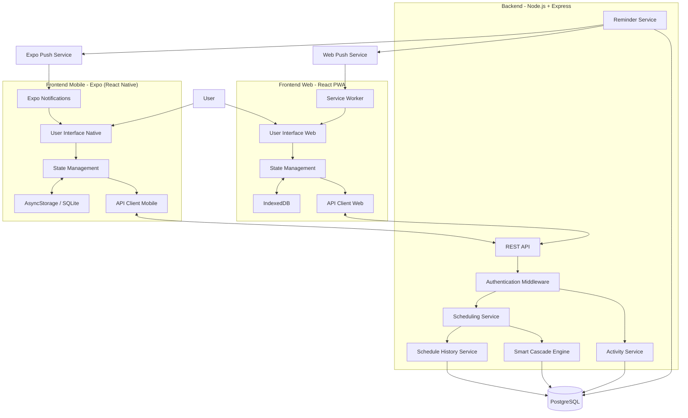
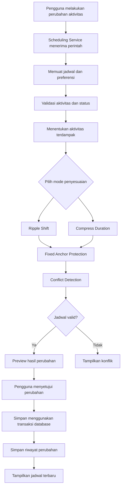
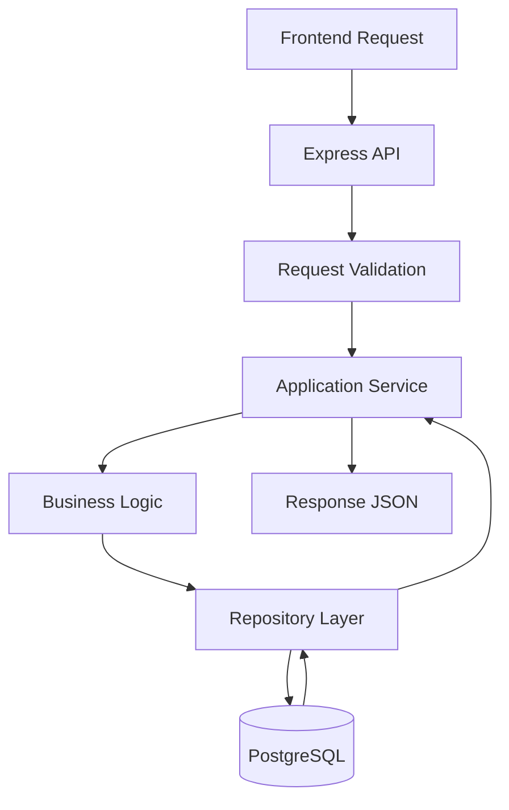
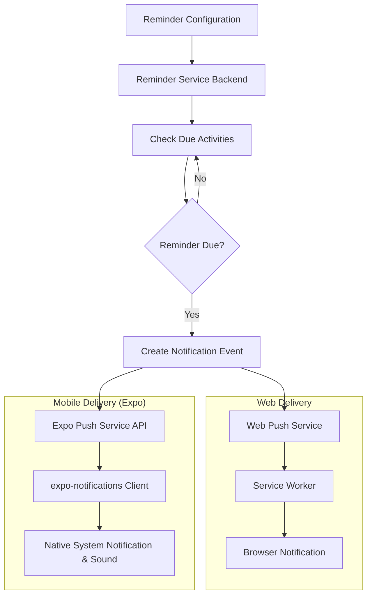

# SYSTEM ARCHITECTURE DOCUMENT
# ClynSchedule
**Dynamic Time-Blocking & Smart Cascade Scheduler**

| Informasi | Detail |
|---|---|
| Nama Proyek | ClynSchedule |
| Nama Dokumen | System Architecture |
| Versi Dokumen | 1.0 |
| Status | Draft |
| Bahasa | Indonesia |
| Referensi | prd.md |

---

# 1. OVERVIEW

## 1.1 Tujuan Dokumen

Dokumen ini menjelaskan rancangan arsitektur teknis ClynSchedule sebagai acuan dalam proses pengembangan aplikasi.

Dokumen mencakup:

- System architecture.
- Technology stack.
- Frontend architecture.
- Backend architecture.
- Database communication.
- API architecture.
- Smart Cascade Engine.
- Data flow.
- Scheduling workflow.
- Notification architecture.
- PWA architecture.
- Security architecture.
- Error handling.
- Technical design decisions.

Dokumen ini harus digunakan sebagai pedoman teknis agar seluruh bagian aplikasi dikembangkan dengan struktur dan pendekatan yang konsisten.

## 1.2 System Overview

ClynSchedule menggunakan arsitektur Client-Server dengan pendekatan Modular Monolith pada backend.

Frontend bertanggung jawab terhadap tampilan aplikasi dan interaksi pengguna, sedangkan backend bertanggung jawab terhadap pengelolaan data, validasi jadwal, dan eksekusi Smart Cascade Engine.

PostgreSQL digunakan sebagai database utama. IndexedDB digunakan untuk penyimpanan lokal dan dukungan penggunaan offline.

## 1.3 Architecture Principles

Seluruh arsitektur ClynSchedule harus mengikuti prinsip berikut:

1. **Modular Architecture:** Setiap modul memiliki tanggung jawab yang jelas.
2. **Separation of Concerns:** UI, business logic, API, dan database tidak boleh dicampur menjadi satu tanggung jawab.
3. **Single Source of Truth:** PostgreSQL menjadi sumber data utama ketika aplikasi terhubung dengan backend.
4. **User Control:** Sistem tidak boleh melakukan perubahan jadwal yang tidak dapat dijelaskan atau dikendalikan pengguna.
5. **Data Integrity:** Setiap perubahan jadwal harus melalui validasi.
6. **Scalability:** Struktur aplikasi harus memungkinkan penambahan fitur tanpa mengubah seluruh sistem.
7. **Reliability:** Smart Cascade harus menghasilkan jadwal yang valid atau memberikan informasi konflik.

---

# 2. TECHNOLOGY STACK

## 2.1 Web Frontend

| Teknologi | Fungsi |
|---|---|
| React | Library untuk membangun antarmuka web |
| TypeScript | Bahasa pemrograman dengan sistem tipe |
| Vite | Development server dan build tool |
| Tailwind CSS | Styling dan design system |
| Lucide React | Ikon antarmuka web |
| React Router | Navigasi halaman web |
| TanStack Query | Pengelolaan server state dan cache API |
| Zustand | Pengelolaan client state |
| IndexedDB | Penyimpanan data lokal |
| vite-plugin-pwa | Dukungan Progressive Web App |

## 2.2 Mobile Frontend (Expo)

| Teknologi | Fungsi |
|---|---|
| React Native | Framework aplikasi mobile cross-platform (Android & iOS) |
| Expo | Platform dan ecosystem toolchain untuk React Native |
| TypeScript | Bahasa pemrograman dengan sistem tipe |
| Expo Router | Navigasi berbasis file (file-based routing) |
| NativeWind / Tailwind CSS | Styling antarmuka mobile berbasis utility classes |
| Lucide React Native | Ikon antarmuka mobile |
| TanStack Query | Pengelolaan server state dan cache API |
| Zustand | Pengelolaan client state |
| AsyncStorage / Expo SQLite | Penyimpanan data lokal dan cache offline di perangkat mobile |
| Expo Notifications | Notifikasi lokal dan push notification perangkat mobile |
| Expo Haptics | Respon getaran haptic untuk aksi pengguna |

## 2.3 Backend

| Teknologi | Fungsi |
|---|---|
| Node.js | Runtime backend |
| Express.js | Framework REST API |
| TypeScript | Bahasa pemrograman backend |
| Zod | Validasi request dan data |
| Prisma ORM | Interaksi database |
| PostgreSQL (Supabase) | Database utama terkelola (Managed Database) |
| Pino | Logging aplikasi |
| Vitest | Unit dan integration testing |

## 2.4 Infrastructure

| Teknologi | Fungsi |
|---|---|
| Supabase | Platform BaaS penyedia PostgreSQL terkelola, Supabase Auth, dan Row Level Security (RLS) |
| IndexedDB & AsyncStorage | Penyimpanan lokal web dan mobile |
| Service Worker | Cache aplikasi dan dukungan offline pada web |
| Expo Application Services (EAS) | Build, deployment, dan update aplikasi mobile |
| Expo Push Service | Layanan pengiriman notifikasi push ke perangkat mobile |
| Web Notifications | Menampilkan notifikasi browser |
| Web Push API | Pengiriman notifikasi push jika diperlukan |

## 2.5 Technology Decision

ClynSchedule menggunakan kombinasi teknologi di atas dengan alasan:

- React memudahkan pengembangan komponen antarmuka web yang dapat digunakan kembali.
- React Native dengan Expo memungkinkan pengembangan satu basis kode mobile untuk Android dan iOS dengan akses API native yang kaya (notifikasi, haptic, storage) tanpa overhead konfigurasi native manual yang kompleks.
- TypeScript digunakan di seluruh layer (Web, Mobile, Backend) untuk konsistensi tipe data dan kemudahan berbagi kontrak skema.
- Expo Router menyederhanakan arsitektur navigasi mobile dengan konsep file-based routing yang selaras dengan mental model pengembangan modern.
- Express.js menyediakan struktur backend yang sederhana dan fleksibel.
- PostgreSQL yang di-host di Supabase mendukung relasi data dan transaksi yang dibutuhkan penjadwalan.
- Prisma membantu pengelolaan database dan migration secara type-safe.
- IndexedDB (Web) dan AsyncStorage / Expo SQLite (Mobile) mendukung penyimpanan lokal untuk reliabilitas offline.
- Supabase menjadi solusi BaaS utama untuk database PostgreSQL terkelola, manajemen autentikasi (Supabase Auth), serta proteksi data via Row Level Security (RLS).

Redis, BullMQ, dan AI API tidak menjadi dependensi MVP.

---

# 3. HIGH-LEVEL SYSTEM ARCHITECTURE

## 3.1 Architecture Diagram



## 3.2 Architecture Layers

### Presentation Layer

Berada pada client (Frontend Web React dan Mobile Expo) dan bertanggung jawab terhadap:

- Menampilkan dashboard dan daily timeline.
- Menampilkan formulir aktivitas.
- Mengelola interaksi pengguna (gestur sentuhan pada mobile, klik/drag pada web).
- Menampilkan notifikasi lokal dan pesan kesalahan.
- Memberikan haptic feedback pada mobile untuk konfirmasi aksi jadwal.
- Mengirim permintaan ke backend melalui API client.

### Application Layer

Berada pada backend dan bertanggung jawab terhadap:

- Memproses permintaan pengguna.
- Mengatur alur bisnis aplikasi.
- Menjalankan layanan penjadwalan.
- Menjalankan Smart Cascade Engine.
- Mengelola riwayat perubahan.

### Domain Layer

Berisi aturan bisnis inti ClynSchedule:

- Activity Rules.
- Scheduling Rules.
- Fixed Anchor Rules.
- Ripple Shift Rules.
- Compress Duration Rules.
- Schedule Validation Rules.

Domain Layer tidak boleh bergantung pada komponen React, Express Request, atau implementasi database secara langsung.

### Data Access Layer

Bertanggung jawab terhadap:

- Query PostgreSQL.
- Pengelolaan data aktivitas.
- Penyimpanan riwayat.
- Pengelolaan preferensi.
- Database transactions.

---

# 4. CLIENT ARCHITECTURE (WEB & MOBILE)

## 4.1 Client Responsibilities

Aplikasi client ClynSchedule hadir dalam dua platform: **Web Client (React PWA)** dan **Mobile Client (Expo / React Native)**. Keduanya berbagi kontrak API dan struktur model data yang sama.

Tanggung jawab client:

1. Menampilkan jadwal harian dan visualisasi timeline waktu.
2. Mengelola interaksi pengguna (touch gesture, tap, drag pada web).
3. Menampilkan status aktivitas (idle, in-progress, completed, delayed).
4. Menyediakan formulir pembuatan dan pembaruan aktivitas.
5. Mengirim perintah penjadwalan ke backend REST API.
6. Menampilkan pratinjau perubahan jadwal hasil Smart Cascade sebelum disetujui.
7. Mengelola cache dan penyimpanan lokal (IndexedDB pada Web, AsyncStorage/SQLite pada Mobile).
8. Menyediakan pengalaman offline dan notifikasi (PWA Service Worker pada Web, Expo Notifications pada Mobile).

Frontend Web maupun Mobile tidak boleh menjadi satu-satunya tempat penyimpanan aturan bisnis Smart Cascade. Perhitungan jadwal yang bersifat otoritatif harus dilakukan dan divalidasi oleh backend.

## 4.2 Web Folder Structure

Struktur direktori aplikasi web berbasis React + Vite (`web/`):

```text
web/
├── public/
│   ├── icons/
│   └── manifest.webmanifest
│
├── src/
│   ├── assets/
│   ├── components/
│   │   ├── ui/
│   │   ├── layout/
│   │   ├── timeline/
│   │   ├── activity/
│   │   └── scheduling/
│   │
│   ├── pages/
│   │   ├── DashboardPage.tsx
│   │   ├── SchedulePage.tsx
│   │   ├── HistoryPage.tsx
│   │   └── SettingsPage.tsx
│   │
│   ├── features/
│   │   ├── activities/
│   │   ├── schedule/
│   │   ├── cascade/
│   │   ├── timer/
│   │   └── notifications/
│   │
│   ├── hooks/
│   ├── services/
│   │   ├── api.ts
│   │   ├── activityService.ts
│   │   └── scheduleService.ts
│   │
│   ├── stores/
│   ├── types/
│   ├── utils/
│   ├── styles/
│   ├── App.tsx
│   └── main.tsx
│
├── index.html
├── vite.config.ts
└── package.json
```

## 4.3 Mobile Folder Structure (Expo)

Struktur direktori aplikasi mobile berbasis React Native dengan Expo dan Expo Router (`mobile/`):

```text
mobile/
├── app/
│   ├── (tabs)/
│   │   ├── _layout.tsx
│   │   ├── index.tsx               # Mobile Dashboard
│   │   ├── schedule.tsx            # Daily Timeline
│   │   ├── history.tsx             # History & Undo Log
│   │   └── settings.tsx            # Settings & Preferences
│   │
│   ├── activity/
│   │   ├── [id].tsx                # Detail & Edit Activity
│   │   └── create.tsx              # Create Activity Modal/Screen
│   │
│   ├── cascade-preview.tsx         # Modal Pratinjau Smart Cascade
│   └── _layout.tsx                 # Root layout & providers
│
├── assets/
│   ├── icon.png
│   ├── splash.png
│   └── adaptive-icon.png
│
├── src/
│   ├── components/
│   │   ├── ui/                     # Native primitive components (Button, Input, Card)
│   │   ├── layout/                 # ScreenContainer, Header, SafeView
│   │   ├── timeline/               # NativeDailyTimeline, TimelineRuler
│   │   ├── activity/               # NativeActivityCard, TimerWidget, AnchorBadge
│   │   └── scheduling/             # ModeSelector, ConflictBanner
│   │
│   ├── hooks/                      # Custom hooks (useTimer, useCascade, useNetworkStatus)
│   ├── services/
│   │   ├── api.ts                  # Axios/Fetch client ke backend API
│   │   ├── activityService.ts      # CRUD aktivitas
│   │   ├── scheduleService.ts      # Eksekusi cascade & trigger
│   │   └── notificationService.ts  # Expo Notifications & permissions
│   │
│   ├── stores/                     # Zustand stores (useActiveActivityStore, useUIStore)
│   ├── storage/                    # AsyncStorage / Expo SQLite offline persistence
│   ├── types/                      # Domain & API TypeScript interfaces
│   ├── utils/                      # Time calculations & formatting
│   └── constants/                  # Colors, Design tokens, Endpoints
│
├── app.json                        # Konfigurasi Expo & EAS
├── babel.config.js
├── tailwind.config.js              # NativeWind configuration
├── tsconfig.json
└── package.json
```

## 4.4 Component Responsibilities (Web & Mobile)

| Komponen Web | Komponen Mobile (Expo) | Tanggung Jawab |
|---|---|---|
| Dashboard | DashboardScreen (`index.tsx`) | Ringkasan jadwal harian dan aktivitas aktif |
| DailyTimeline | NativeDailyTimeline | Visualisasi timeline berbasis waktu (vertikal pada mobile) |
| ActivityCard | NativeActivityCard | Menampilkan info aktivitas, status badge, dan countdown |
| ActivityForm | ActivityModal / Screen | Membuat dan memperbarui data aktivitas |
| ActivityTimer | NativeActivityTimer | Menghitung waktu aktivitas berjalan secara realtime |
| CascadePreview | CascadePreviewModal | Pratinjau pergeseran jadwal sebelum dieksekusi |
| AnchorBadge | AnchorBadge | Visual penanda Fixed Anchor block |
| ScheduleModeSelector | ModeSegmentedControl | Memilih mode Ripple Shift atau Compress Duration |
| ConflictAlert | ConflictBanner / Toast | Menampilkan peringatan benturan jadwal |
| HistoryPanel | HistoryScreen (`history.tsx`) | Menampilkan riwayat perubahan dan tombol Undo |

## 4.5 State Management & Storage Strategy

- **Client State (Zustand):**
  - Digunakan identik baik di Web maupun Mobile untuk mengelola UI state lokal: aktivitas yang sedang berjalan, timer status, filter visual, dan modal/bottom sheet state.
- **Server State (TanStack Query):**
  - Digunakan di Web dan Mobile untuk fetching, caching, deduplikasi, dan background revalidation data aktivitas serta riwayat jadwal dari backend.
- **Persistent Local Storage:**
  - **Web:** IndexedDB digunakan untuk menyimpan cache aktivitas dan antrean offline PWA.
  - **Mobile:** AsyncStorage untuk data preferensi/auth token, dan Expo SQLite / AsyncStorage untuk cache aktivitas lokal dan antrean mutasi offline.

Data server tidak boleh diduplikasi secara tidak terkendali pada beberapa state global.

---

# 5. BACKEND ARCHITECTURE

## 5.1 Backend Architecture Pattern

Backend menggunakan pendekatan Modular Monolith.

Setiap modul memiliki tanggung jawab terpisah, tetapi seluruh modul berjalan dalam satu aplikasi Node.js.

Pendekatan ini dipilih karena:

- Lebih sederhana untuk MVP.
- Mudah dikembangkan dan diuji.
- Tidak membutuhkan komunikasi antar-microservices.
- Memudahkan pengelolaan transaksi database.
- Memungkinkan pemisahan modul ketika aplikasi berkembang.

## 5.2 Backend Responsibilities

Backend bertanggung jawab terhadap:

1. Menyediakan REST API.
2. Memvalidasi request.
3. Mengelola aktivitas.
4. Menjalankan algoritma penjadwalan.
5. Melindungi Fixed Anchor.
6. Mendeteksi konflik jadwal.
7. Menyimpan riwayat perubahan.
8. Mengelola autentikasi dan otorisasi.
9. Menyediakan data kepada frontend.

## 5.3 Backend Folder Structure

```text
backend/
├── prisma/
│   ├── schema.prisma
│   └── migrations/
│
├── src/
│   ├── config/
│   │   ├── env.ts
│   │   └── database.ts
│   │
│   ├── modules/
│   │   ├── activities/
│   │   │   ├── activity.controller.ts
│   │   │   ├── activity.service.ts
│   │   │   ├── activity.repository.ts
│   │   │   ├── activity.routes.ts
│   │   │   └── activity.schema.ts
│   │   │
│   │   ├── scheduling/
│   │   │   ├── schedule.controller.ts
│   │   │   ├── schedule.service.ts
│   │   │   ├── schedule.repository.ts
│   │   │   └── schedule.routes.ts
│   │   │
│   │   ├── cascade/
│   │   │   ├── cascade.engine.ts
│   │   │   ├── ripple-shift.ts
│   │   │   ├── compress-duration.ts
│   │   │   ├── conflict-detector.ts
│   │   │   └── anchor-protection.ts
│   │   │
│   │   ├── history/
│   │   │   ├── history.service.ts
│   │   │   └── history.repository.ts
│   │   │
│   │   ├── reminders/
│   │   │   └── reminder.service.ts
│   │   │
│   │   └── auth/
│   │       └── auth.middleware.ts
│   │
│   ├── shared/
│   │   ├── errors/
│   │   ├── middleware/
│   │   ├── types/
│   │   └── utils/
│   │
│   ├── app.ts
│   └── server.ts
│
├── tests/
├── package.json
└── tsconfig.json
```

## 5.4 Module Responsibilities

### Activities Module

Mengelola operasi CRUD aktivitas.

### Scheduling Module

Mengelola jadwal harian dan mengatur alur penyesuaian.

### Cascade Module

Menjalankan logika Smart Cascade, termasuk Ripple Shift, Compress Duration, dan Conflict Detection.

### History Module

Menyimpan perubahan jadwal dan menyediakan data untuk Undo.

### Reminders Module

Mengelola aturan pengingat aktivitas.

### Auth Module

Memverifikasi identitas pengguna dan membatasi akses data berdasarkan kepemilikan.

---

# 6. SMART CASCADE ENGINE ARCHITECTURE

## 6.1 Overview

Smart Cascade Engine merupakan komponen inti ClynSchedule.

Engine ini bertugas menghitung perubahan waktu aktivitas berdasarkan perubahan yang terjadi pada jadwal.

Engine harus bersifat deterministik: input dan konfigurasi yang sama harus menghasilkan hasil perhitungan yang sama.

## 6.2 Scheduling Concepts

### Flexible Block

Aktivitas yang boleh mengalami perubahan waktu secara otomatis.

Karakteristik:

- Waktu mulai dapat digeser.
- Waktu selesai dapat disesuaikan.
- Durasi dapat dikompresi jika diizinkan.
- Memiliki batas minimum durasi.

### Fixed Anchor Block

Aktivitas yang memiliki waktu tetap.

Karakteristik:

- Waktu mulai dilindungi.
- Waktu selesai dilindungi.
- Tidak boleh digeser oleh Smart Cascade.
- Dapat menjadi batas atau pemisah proses penyesuaian jadwal.

### Activity Status

Status aktivitas:

- Pending.
- Active.
- Completed.
- Skipped.

Aktivitas Completed dan Skipped tidak boleh diubah secara tidak sengaja oleh proses cascade.

## 6.3 Scheduling Modes

### A. Ripple Shift

Ripple Shift menggeser aktivitas fleksibel berikutnya berdasarkan perubahan waktu aktivitas sebelumnya.

Contoh:

Jadwal awal:

| Aktivitas | Waktu |
|---|---|
| Belajar CPNS | 08.00–10.00 |
| Coding | 10.00–12.00 |
| Mencari Lowongan | 13.00–14.00 |

Jika aktivitas pertama selesai pukul 11.00, sistem menghitung ulang jadwal fleksibel berikutnya.

Prinsip:

- Mempertahankan durasi aktivitas.
- Menggeser waktu aktivitas berikutnya.
- Tidak mengubah Fixed Anchor.
- Memvalidasi benturan jadwal dan batas akhir hari.

### B. Compress Duration

Compress Duration mengurangi durasi aktivitas fleksibel untuk mengakomodasi perubahan jadwal.

Prinsip:

- Hanya aktivitas yang mengizinkan kompresi yang dapat diubah.
- Durasi tidak boleh kurang dari minDuration.
- Prioritas dan urutan aktivitas tetap dipertahankan.
- Fixed Anchor tetap dilindungi.
- Jika kapasitas kompresi tidak mencukupi, sistem mengembalikan konflik.

## 6.4 Smart Cascade Workflow



## 6.5 Cascade Engine Rules

1. Seluruh perhitungan menggunakan satuan menit.
2. Jadwal harus diurutkan berdasarkan waktu.
3. Fixed Anchor tidak boleh mengalami pergeseran otomatis.
4. Durasi aktivitas tidak boleh negatif atau kurang dari minimum.
5. Aktivitas Completed tidak boleh diubah tanpa tindakan khusus pengguna.
6. Aktivitas Skipped tidak boleh dijadwalkan ulang secara otomatis.
7. Sistem harus memeriksa benturan waktu.
8. Sistem harus memeriksa batas akhir hari.
9. Perubahan yang tidak valid harus ditolak.
10. Perubahan harus disimpan secara atomik.

## 6.6 Cascade Preview

Sebelum perubahan diterapkan, sistem sebaiknya menyediakan preview yang memperlihatkan:

- Aktivitas yang mengalami perubahan.
- Waktu sebelum perubahan.
- Waktu sesudah perubahan.
- Durasi yang berubah.
- Aktivitas yang tidak dapat digeser.
- Konflik yang ditemukan.

Pengguna harus dapat menyetujui atau membatalkan perubahan tersebut.

---

# 7. TIME MANAGEMENT & SCHEDULING RULES

## 7.1 Time Representation

Untuk kebutuhan perhitungan penjadwalan harian, sistem menggunakan integer berupa jumlah menit sejak pukul 00.00.

Contoh:

| Waktu | Nilai |
|---|---:|
| 08.00 | 480 |
| 09.00 | 540 |
| 10.00 | 600 |
| 12.30 | 750 |
| 23.00 | 1380 |

Durasi dihitung dengan:

`duration = endTime - startTime`

Representasi ini digunakan untuk mempermudah operasi matematika pada Smart Cascade Engine.

Untuk penyimpanan permanen, sistem tetap menyimpan tanggal aktivitas dan timezone yang relevan.

## 7.2 Date and Timezone

- Setiap aktivitas harus memiliki tanggal.
- Setiap pengguna memiliki timezone.
- Default timezone awal: Asia/Makassar.
- Waktu lokal harus diproses secara konsisten.
- Penyimpanan timestamp harus menggunakan standar yang konsisten.
- Perhitungan jadwal tidak boleh mengasumsikan semua pengguna berada pada timezone yang sama.

## 7.3 Fixed Anchor Boundary

Fixed Anchor merupakan batas waktu yang tidak boleh dilanggar.

Contoh:

```text
08.00 - 09.00  Flexible Activity
09.00 - 10.00  Fixed Anchor
10.00 - 11.00  Flexible Activity
```

Aktivitas sebelum dan sesudah Fixed Anchor harus divalidasi secara terpisah.

Sistem tidak boleh menggeser Fixed Anchor hanya untuk mempertahankan urutan jadwal.

## 7.4 Conflict Handling

Jenis konflik:

- Overlapping Activity.
- Fixed Anchor Collision.
- Insufficient Compression Capacity.
- End-of-Day Overflow.
- Invalid Duration.
- Invalid Activity State.

Sistem harus mengembalikan informasi konflik yang dapat dipahami pengguna.

---

# 8. API ARCHITECTURE

## 8.1 API Design

Backend menyediakan REST API dengan format JSON.

Base URL:

```text
/api/v1
```

Semua endpoint harus menggunakan HTTP method dan status code yang sesuai.

## 8.2 Activity Endpoints

| Method | Endpoint | Fungsi |
|---|---|---|
| GET | /activities | Mengambil daftar aktivitas |
| GET | /activities/:id | Mengambil detail aktivitas |
| POST | /activities | Membuat aktivitas |
| PATCH | /activities/:id | Mengubah aktivitas |
| DELETE | /activities/:id | Menghapus aktivitas |

## 8.3 Scheduling Endpoints

| Method | Endpoint | Fungsi |
|---|---|---|
| GET | /schedules/:date | Mengambil jadwal harian |
| POST | /schedules/:date/re-align | Menyelaraskan jadwal |
| POST | /schedules/cascade/preview | Menghitung preview cascade |
| POST | /schedules/cascade/apply | Menerapkan hasil cascade |

## 8.4 Activity Action Endpoints

| Method | Endpoint | Fungsi |
|---|---|---|
| POST | /activities/:id/start | Memulai aktivitas |
| POST | /activities/:id/complete | Menyelesaikan aktivitas |
| POST | /activities/:id/skip | Melewati aktivitas |
| POST | /activities/:id/pause | Menjeda timer |
| POST | /activities/:id/resume | Melanjutkan timer |

## 8.5 History Endpoints

| Method | Endpoint | Fungsi |
|---|---|---|
| GET | /history | Mengambil riwayat perubahan |
| POST | /history/:id/undo | Membatalkan perubahan |

## 8.6 API Response Format

Format respons berhasil:

```json
{
  "success": true,
  "message": "Jadwal berhasil diperbarui",
  "data": {}
}
```

Format respons gagal:

```json
{
  "success": false,
  "message": "Terjadi konflik jadwal",
  "error": {
    "code": "SCHEDULE_CONFLICT",
    "details": []
  }
}
```

## 8.7 API Validation

Setiap request harus divalidasi sebelum diproses.

Validasi meliputi:

- Format tanggal.
- Waktu mulai dan selesai.
- Durasi.
- Status aktivitas.
- Jenis blok.
- Izin kompresi.
- Kepemilikan aktivitas.
- Mode penyesuaian jadwal.

---

# 9. DATABASE COMMUNICATION

## 9.1 Database Strategy

PostgreSQL menjadi database utama.

Prisma ORM digunakan untuk:

- Query database.
- Relasi tabel.
- Validasi tipe data pada tingkat aplikasi.
- Database migration.
- Transaction management.

## 9.2 Database Interaction Flow



## 9.3 Transaction Requirements

Perubahan jadwal yang melibatkan beberapa aktivitas harus menggunakan database transaction.

Contoh:

Ketika Smart Cascade menggeser lima aktivitas, seluruh perubahan harus berhasil disimpan bersama-sama.

Jika satu perubahan gagal, seluruh transaksi harus dibatalkan.

Hal ini mencegah kondisi ketika sebagian aktivitas telah berubah sedangkan aktivitas lainnya masih menggunakan jadwal lama.

## 9.4 Concurrency Control

Setiap perubahan jadwal harus mempertimbangkan kemungkinan perubahan bersamaan.

Untuk MVP:

- Gunakan transaksi database.
- Gunakan optimistic locking melalui versi atau updatedAt.
- Tolak perubahan jika jadwal telah berubah sejak preview dibuat.
- Minta frontend memuat ulang data sebelum mencoba kembali.

---

# 10. LOCAL STORAGE & OFFLINE ARCHITECTURE

## 10.1 Storage Solution (Web & Mobile)

- **Web (IndexedDB):**
  - Cache aktivitas dan timeline harian yang telah dimuat.
  - Preferensi tampilan dan status UI.
  - Data sementara untuk dukungan offline PWA.
- **Mobile (AsyncStorage & Expo SQLite):**
  - **AsyncStorage:** Menyimpan token autentikasi, pengaturan pengguna, preferensi tema, dan cache snapshot jadwal ringan.
  - **Expo SQLite:** Menyimpan replika lokal aktivitas dan antrean mutasi (offline mutation queue) saat perangkat offline.

## 10.2 Offline Behavior

Ketika tidak tersedia koneksi internet:

- Pengguna web maupun mobile dapat melihat jadwal yang sebelumnya tersimpan secara lokal.
- Pengguna dapat melihat informasi aktivitas yang tersedia di cache.
- Perubahan offline dapat disimpan sebagai operasi tertunda ke antrean lokal jika mekanisme offline queue aktif.
- Indikator status jaringan (online/offline) ditampilkan di antarmuka.
- Sistem tidak boleh menganggap perubahan lokal sudah tersinkronisasi dengan server sebelum backend memberikan konfirmasi.

## 10.3 Synchronization

Saat koneksi kembali tersedia:

1. Sistem memeriksa operasi lokal yang tertunda di IndexedDB atau SQLite/AsyncStorage.
2. Sistem memeriksa versi data server (optimistic concurrency check).
3. Sistem mengirim perubahan yang masih valid secara berurutan.
4. Backend melakukan validasi ulang terhadap aturan Smart Cascade dan batas waktu.
5. Konflik sinkronisasi dilaporkan kepada pengguna untuk konfirmasi.
6. Data lokal diperbarui berdasarkan respons resmi server.

Untuk MVP, dukungan offline dapat dimulai dengan mode baca (read-only) terhadap data yang sudah tersimpan. Sinkronisasi dua arah penuh dapat ditingkatkan secara bertahap.

---

# 11. NOTIFICATION ARCHITECTURE

## 11.1 Notification Types

- Activity Starting Reminder.
- Upcoming Activity Reminder (misal 5-15 menit sebelum mulai).
- Activity Delay Reminder (saat aktivitas melebihi batas durasi).
- Schedule Change Notification (hasil pergeseran Smart Cascade).

## 11.2 Notification Architecture (Web & Mobile)



## 11.3 Mobile Local Scheduling vs Remote Push

Pada aplikasi mobile berbasis Expo, pengingat memiliki keandalan tinggi melalui dua metode:
1. **Local Scheduled Notifications (`expo-notifications`):**
   - Jadwal pengingat aktivitas yang telah ditentukan dijadwalkan langsung pada sistem operasi (Android AlarmManager / iOS Notification Center).
   - Pengingat tetap menyala dan bersuara tepat waktu meskipun aplikasi sedang ditutup atau tanpa koneksi internet.
2. **Remote Push Notifications (Expo Push Service):**
   - Digunakan ketika backend memicu perubahan jadwal mendadak, notifikasi darurat, atau penyesuaian lintas perangkat.

## 11.4 Notification Limitations

- Browser Web Notification membutuhkan izin pengguna dan Service Worker memiliki keterbatasan jika browser ditutup penuh.
- Mobile Push memerlukan izin notifikasi sistem (Notification Permission) dan registrasi Expo Push Token ke backend.
- Pengingat yang harus tetap berjalan ketika aplikasi tidak aktif memerlukan kombinasi local alarm scheduling dan remote push delivery.

---

# 12. SECURITY ARCHITECTURE

## 12.1 Authentication

Autentikasi pengguna dikelola secara terpusat menggunakan **Supabase Auth**. Client (Web dan Mobile) melakukan login/register menggunakan Supabase client SDK, dan token JWT Supabase dikirimkan pada header `Authorization: Bearer <token>` ke backend Express.

Backend memverifikasi keabsahan JWT Supabase sebelum mengizinkan akses ke data dan endpoint private.

## 12.2 Authorization

- Pengguna hanya dapat mengakses aktivitas miliknya (`user_id` matching).
- Setiap query database pada backend memfilter berdasarkan `userId` terverifikasi.
- Pada level database Supabase, Row Level Security (RLS) diaktifkan untuk memastikan proteksi akses ganda.
- Endpoint yang mengubah jadwal memeriksa kepemilikan data sebelum menjalankan operasi.

## 12.3 Input Validation

- Gunakan Zod untuk validasi request.
- Batasi nilai durasi.
- Validasi tanggal dan waktu.
- Tolak data yang tidak sesuai aturan.
- Jangan mempercayai perhitungan jadwal yang hanya berasal dari frontend.

## 12.4 Environment Variables

Informasi sensitif harus disimpan di environment variables.

Contoh:

```env
PORT=3000
DATABASE_URL=
SUPABASE_URL=
SUPABASE_ANON_KEY=
SUPABASE_SERVICE_ROLE_KEY=
```

Jangan pernah menyimpan secret key di dalam source code frontend atau repository publik.

---

# 13. ERROR HANDLING & LOGGING

## 13.1 Error Categories

| Kode | Keterangan |
|---|---|
| VALIDATION_ERROR | Input tidak valid |
| ACTIVITY_NOT_FOUND | Aktivitas tidak ditemukan |
| UNAUTHORIZED | Pengguna belum terautentikasi |
| FORBIDDEN | Pengguna tidak memiliki akses |
| SCHEDULE_CONFLICT | Jadwal mengalami benturan |
| ANCHOR_PROTECTED | Perubahan melanggar aturan Fixed Anchor |
| COMPRESSION_LIMIT_REACHED | Durasi minimum telah tercapai |
| SCHEDULE_OUT_OF_RANGE | Jadwal melewati batas waktu |
| VERSION_CONFLICT | Data telah berubah sejak terakhir dimuat |
| INTERNAL_SERVER_ERROR | Kesalahan internal server |

## 13.2 Logging

Backend menggunakan structured logging untuk mencatat:

- API request.
- API response status.
- Error.
- Proses cascade.
- Konflik jadwal.
- Database transaction failure.

Jangan mencatat token autentikasi, password, atau informasi sensitif pengguna.

---

# 14. TESTING ARCHITECTURE

## 14.1 Unit Testing

Menguji fungsi yang terpisah.

Fokus:

- Ripple Shift algorithm.
- Compress Duration algorithm.
- Fixed Anchor Protection logic.
- Conflict Detection.
- Time Calculation (minutes, slot offset, timezone).
- Activity Status Validation.
- Utility functions pada Web dan Mobile.

## 14.2 Integration & Component Testing

Menguji komunikasi antar modul dan rendering komponen antarmuka.

Fokus:

- Activity API dan Scheduling API di backend.
- Database Transaction & rollback test.
- History Recording & Undo flow.
- Authentication Middleware.
- React Testing Library untuk komponen Web UI.
- React Native Testing Library (RNTL) untuk komponen Mobile Expo (DashboardScreen, Timeline, ActivityCard).

## 14.3 End-to-End Testing

Menguji alur penggunaan dari sisi pengguna pada browser dan simulator mobile.

Skenario:

1. Membuat aktivitas baru (flexible & fixed anchor).
2. Memulai aktivitas (Start Now).
3. Mengalami keterlambatan aktivitas.
4. Melakukan Re-align Now.
5. Menjalankan simulasi Cascade Preview (Ripple Shift / Compress Duration).
6. Memastikan Fixed Anchor tidak berubah posisi atau terpotong.
7. Menyelesaikan aktivitas (Complete) dan memeriksa rekaman history.
8. Memastikan perubahan data tersinkronisasi ke server.

## 14.4 Critical Test Cases

Smart Cascade tidak boleh dinyatakan siap sebelum skenario berikut diuji:

- Keterlambatan aktivitas selama 15 menit.
- Keterlambatan aktivitas selama 60 menit.
- Aktivitas selesai lebih cepat.
- Aktivitas dilewati (Skip).
- Aktivitas fleksibel sebelum Fixed Anchor.
- Aktivitas fleksibel setelah Fixed Anchor.
- Durasi minimum telah tercapai saat kompresi.
- Tidak ada waktu tersisa untuk penyesuaian (Hard Conflict).
- Dua aktivitas mengalami benturan jadwal.
- Dua request cascade dikirim secara bersamaan (Concurrency test).

---

# 15. DEPLOYMENT ARCHITECTURE

## 15.1 Development Environment

Web Frontend:

```bash
cd web
npm run dev
```

Mobile Frontend (Expo):

```bash
cd mobile
npx expo start
```

Backend:

```bash
cd backend
npm run dev
```

Database:

- PostgreSQL lokal atau Supabase development project.

## 15.2 Production Environment

Komponen deployment:

- **Web Frontend:** Static hosting (Vercel, Netlify, Cloudflare Pages) dengan konfigurasi SPA & PWA.
- **Mobile Frontend (Expo):** EAS Build untuk menghasilkan binary Android (`.apk`/`.aab`) dan iOS (`.ipa`), serta EAS Update untuk over-the-air update.
- **Backend:** Node.js hosting (Render, Railway, Fly.io, VPS) dengan process manager.
- **Database:** PostgreSQL managed hosting (Supabase / AWS RDS).
- **Environment:** Environment variables yang aman dan terisolasi.

Web, mobile, dan backend dapat di-deploy secara independen dengan mengacu pada REST API contract yang sama.

## 15.3 Environment Separation

Gunakan lingkungan terpisah:

- Development.
- Testing.
- Production.

Jangan menggunakan database production untuk eksperimen atau pengujian migration.

---

# 16. ARCHITECTURAL DECISION RECORD (ADR)

Keputusan arsitektur berikut menjadi acuan awal proyek.

| ID | Keputusan | Alasan |
|---|---|---|
| ADR-001 | React + TypeScript | UI web modular dan type safety |
| ADR-002 | Node.js + Express.js | Backend sederhana, cepat, dan fleksibel |
| ADR-003 | Modular Monolith | Menghindari kompleksitas microservices pada MVP |
| ADR-004 | PostgreSQL (Supabase) | Relasi data, transaksi ACID kuat, serta platform BaaS terkelola dengan Supabase Auth & RLS |
| ADR-005 | Prisma ORM | Pengelolaan query type-safe dan migration terstruktur |
| ADR-006 | Smart Cascade di backend | Konsistensi aturan dan validasi penjadwalan otoritatif |
| ADR-007 | IndexedDB & AsyncStorage | Dukungan penyimpanan lokal dan offline untuk web dan mobile |
| ADR-008 | Fixed Anchor Protection | Melindungi aktivitas berjadwal pasti agar tidak bergeser otomatis |
| ADR-009 | Integer minutes untuk perhitungan harian | Mempermudah kalkulasi jadwal dan menghindari masalah floating point |
| ADR-010 | REST API | Komunikasi client dan server yang sederhana dan terstandardisasi |
| ADR-011 | Expo (React Native) untuk Mobile | Satu basis kode TypeScript untuk Android & iOS, navigasi file-based dengan Expo Router, akses notifikasi & haptic native, serta build terkelola dengan EAS |

Perubahan keputusan arsitektur harus memiliki alasan teknis yang jelas dan memperbarui dokumen ini.

---

# 17. ARCHITECTURAL CONSTRAINTS

Seluruh implementasi harus mematuhi batasan berikut:

1. Jangan memindahkan Smart Cascade Engine sepenuhnya ke frontend atau client mobile.
2. Jangan mencampurkan business logic ke dalam React / React Native components.
3. Jangan menempatkan seluruh backend logic dalam satu controller.
4. Jangan melakukan query database langsung dari komponen UI.
5. Jangan mengubah Fixed Anchor secara otomatis.
6. Jangan menyimpan perubahan jadwal parsial tanpa transaction.
7. Jangan menghapus migration lama untuk memperbaiki perubahan schema yang sudah diterapkan.
8. Jangan menambahkan Redis, microservices, atau AI API tanpa kebutuhan yang jelas.
9. Jangan menganggap Service Worker dapat menjalankan timer tanpa batas ketika browser ditutup.
10. Jangan mengubah technology stack tanpa mengevaluasi dampaknya terhadap seluruh sistem.

---

# 18. FINAL ARCHITECTURE DEFINITION

ClynSchedule menggunakan arsitektur Client-Server multi-platform dengan Web Client (React + TypeScript PWA), Mobile Client (React Native + TypeScript via Expo), backend Node.js + Express.js menggunakan pendekatan Modular Monolith, serta PostgreSQL yang di-host melalui **Supabase** sebagai database utama dan penyedia layanan autentikasi (Supabase Auth).

Smart Cascade Engine ditempatkan pada backend sebagai komponen domain utama yang bertanggung jawab terhadap penyesuaian jadwal melalui Ripple Shift dan Compress Duration.

Fixed Anchor Protection, Conflict Detection, dan Database Transaction menjadi bagian penting untuk memastikan setiap perubahan jadwal tetap aman, konsisten, dan dapat diprediksi. Proteksi keamanan diperkuat dengan Supabase Row Level Security (RLS).

IndexedDB (Web) dan AsyncStorage / SQLite (Mobile) digunakan untuk mendukung pengalaman aplikasi yang responsif serta penggunaan data lokal dan offline. Expo Notifications menjamin pengingat aktivitas dapat berbunyi andal di perangkat mobile.

Arsitektur ini dirancang agar tetap sederhana untuk MVP, namun tangguh dan siap dikembangkan untuk sinkronisasi multi-perangkat, analitik produktivitas, serta integrasi kecerdasan buatan di masa mendatang.

**Prinsip arsitektur:**

"Build simple. Keep it modular. Make scheduling reliable across web and mobile with Supabase foundation."

---

**END OF DOCUMENT — ClynSchedule Architecture v1.1**