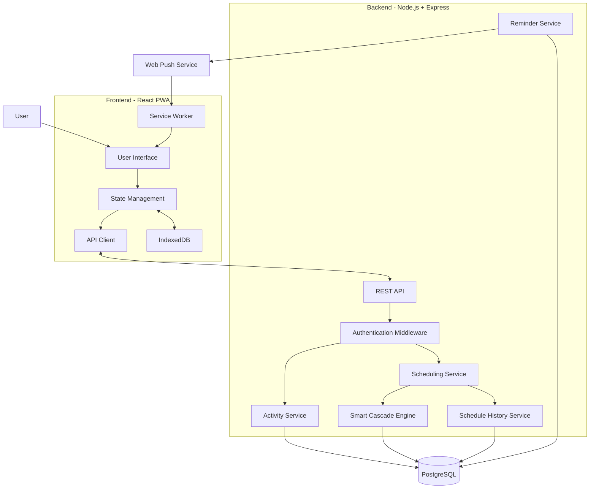
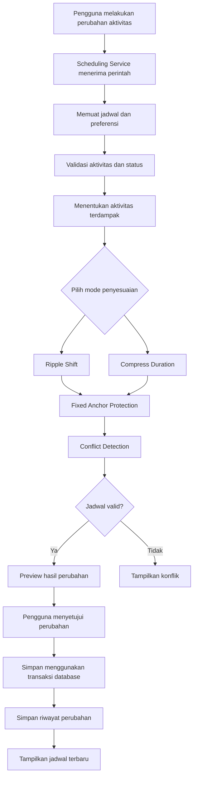
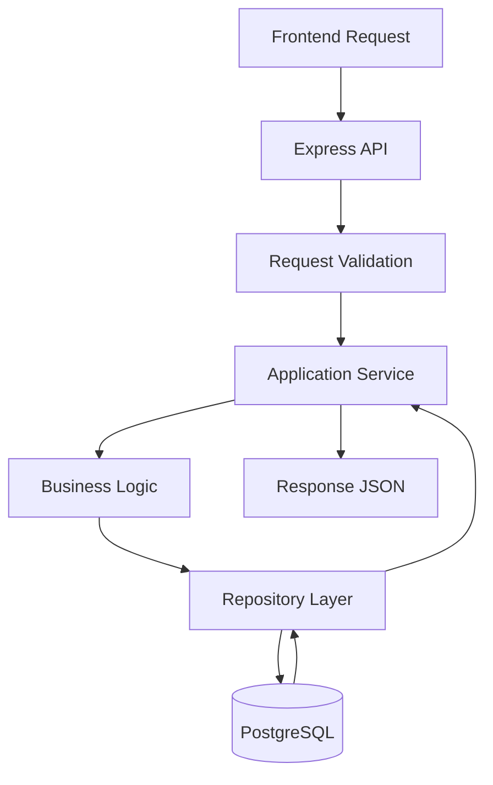
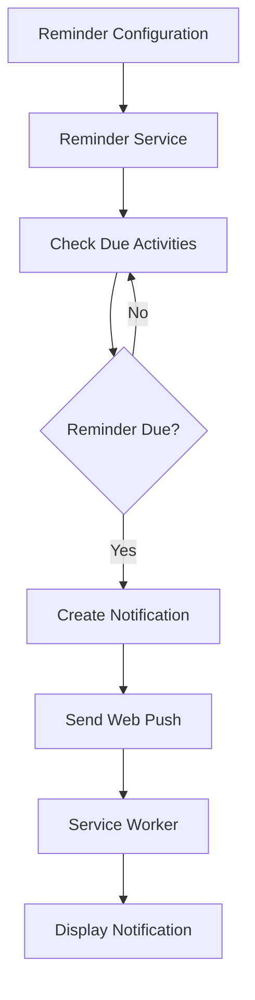

# SYSTEM ARCHITECTURE DOCUMENT
# ClynSchedule
**Dynamic Time-Blocking & Smart Cascade Scheduler**

| Informasi | Detail |
|---|---|
| Nama Proyek | ClynSchedule |
| Nama Dokumen | System Architecture |
| Versi Dokumen | 1.0 |
| Status | Draft |
| Bahasa | Indonesia |
| Referensi | prd.md |

---

# 1. OVERVIEW

## 1.1 Tujuan Dokumen

Dokumen ini menjelaskan rancangan arsitektur teknis ClynSchedule sebagai acuan dalam proses pengembangan aplikasi.

Dokumen mencakup:

- System architecture.
- Technology stack.
- Frontend architecture.
- Backend architecture.
- Database communication.
- API architecture.
- Smart Cascade Engine.
- Data flow.
- Scheduling workflow.
- Notification architecture.
- PWA architecture.
- Security architecture.
- Error handling.
- Technical design decisions.

Dokumen ini harus digunakan sebagai pedoman teknis agar seluruh bagian aplikasi dikembangkan dengan struktur dan pendekatan yang konsisten.

## 1.2 System Overview

ClynSchedule menggunakan arsitektur Client-Server dengan pendekatan Modular Monolith pada backend.

Frontend bertanggung jawab terhadap tampilan aplikasi dan interaksi pengguna, sedangkan backend bertanggung jawab terhadap pengelolaan data, validasi jadwal, dan eksekusi Smart Cascade Engine.

PostgreSQL digunakan sebagai database utama. IndexedDB digunakan untuk penyimpanan lokal dan dukungan penggunaan offline.

## 1.3 Architecture Principles

Seluruh arsitektur ClynSchedule harus mengikuti prinsip berikut:

1. **Modular Architecture:** Setiap modul memiliki tanggung jawab yang jelas.
2. **Separation of Concerns:** UI, business logic, API, dan database tidak boleh dicampur menjadi satu tanggung jawab.
3. **Single Source of Truth:** PostgreSQL menjadi sumber data utama ketika aplikasi terhubung dengan backend.
4. **User Control:** Sistem tidak boleh melakukan perubahan jadwal yang tidak dapat dijelaskan atau dikendalikan pengguna.
5. **Data Integrity:** Setiap perubahan jadwal harus melalui validasi.
6. **Scalability:** Struktur aplikasi harus memungkinkan penambahan fitur tanpa mengubah seluruh sistem.
7. **Reliability:** Smart Cascade harus menghasilkan jadwal yang valid atau memberikan informasi konflik.

---

# 2. TECHNOLOGY STACK

## 2.1 Frontend

| Teknologi | Fungsi |
|---|---|
| React | Library untuk membangun antarmuka |
| TypeScript | Bahasa pemrograman dengan sistem tipe |
| Vite | Development server dan build tool |
| Tailwind CSS | Styling dan design system |
| Lucide React | Ikon antarmuka |
| React Router | Navigasi halaman |
| TanStack Query | Pengelolaan server state dan cache API |
| Zustand | Pengelolaan client state |
| IndexedDB | Penyimpanan data lokal |
| vite-plugin-pwa | Dukungan Progressive Web App |

## 2.2 Backend

| Teknologi | Fungsi |
|---|---|
| Node.js | Runtime backend |
| Express.js | Framework REST API |
| TypeScript | Bahasa pemrograman backend |
| Zod | Validasi request dan data |
| Prisma ORM | Interaksi database |
| PostgreSQL | Database utama |
| Pino | Logging aplikasi |
| Vitest | Unit dan integration testing |

## 2.3 Infrastructure

| Teknologi | Fungsi |
|---|---|
| Supabase | Hosting PostgreSQL dan layanan autentikasi opsional |
| IndexedDB | Penyimpanan lokal |
| Service Worker | Cache aplikasi dan dukungan offline |
| Web Notifications | Menampilkan notifikasi browser |
| Web Push API | Pengiriman notifikasi push jika diperlukan |

## 2.4 Technology Decision

ClynSchedule menggunakan kombinasi teknologi di atas dengan alasan:

- React memudahkan pengembangan komponen antarmuka yang dapat digunakan kembali.
- TypeScript membantu mengurangi kesalahan tipe data.
- Express.js menyediakan struktur backend yang sederhana dan fleksibel.
- PostgreSQL mendukung relasi data dan transaksi yang dibutuhkan penjadwalan.
- Prisma membantu pengelolaan database dan migration.
- IndexedDB mendukung penyimpanan lokal.
- Supabase dapat digunakan untuk mengurangi kompleksitas pengelolaan infrastruktur database dan autentikasi.

Redis, BullMQ, dan AI API tidak menjadi dependensi MVP.

---

# 3. HIGH-LEVEL SYSTEM ARCHITECTURE

## 3.1 Architecture Diagram



## 3.2 Architecture Layers

### Presentation Layer

Berada pada frontend dan bertanggung jawab terhadap:

- Menampilkan dashboard.
- Menampilkan timeline.
- Menampilkan formulir aktivitas.
- Mengelola interaksi pengguna.
- Menampilkan notifikasi dan pesan kesalahan.
- Mengirim permintaan ke backend.

### Application Layer

Berada pada backend dan bertanggung jawab terhadap:

- Memproses permintaan pengguna.
- Mengatur alur bisnis aplikasi.
- Menjalankan layanan penjadwalan.
- Menjalankan Smart Cascade Engine.
- Mengelola riwayat perubahan.

### Domain Layer

Berisi aturan bisnis inti ClynSchedule:

- Activity Rules.
- Scheduling Rules.
- Fixed Anchor Rules.
- Ripple Shift Rules.
- Compress Duration Rules.
- Schedule Validation Rules.

Domain Layer tidak boleh bergantung pada komponen React, Express Request, atau implementasi database secara langsung.

### Data Access Layer

Bertanggung jawab terhadap:

- Query PostgreSQL.
- Pengelolaan data aktivitas.
- Penyimpanan riwayat.
- Pengelolaan preferensi.
- Database transactions.

---

# 4. FRONTEND ARCHITECTURE

## 4.1 Frontend Responsibilities

Frontend bertanggung jawab untuk:

1. Menampilkan jadwal harian.
2. Mengelola interaksi pengguna.
3. Menampilkan status aktivitas.
4. Menyediakan formulir aktivitas.
5. Mengirim perintah penjadwalan ke backend.
6. Menampilkan hasil Smart Cascade.
7. Mengelola cache dan penyimpanan lokal.
8. Menyediakan pengalaman PWA.

Frontend tidak boleh menjadi satu-satunya tempat penyimpanan aturan bisnis Smart Cascade.

Perhitungan jadwal yang bersifat otoritatif harus dilakukan dan divalidasi oleh backend.

## 4.2 Frontend Folder Structure

```text
frontend/
├── public/
│   ├── icons/
│   └── manifest.webmanifest
│
├── src/
│   ├── assets/
│   │
│   ├── components/
│   │   ├── ui/
│   │   ├── layout/
│   │   ├── timeline/
│   │   ├── activity/
│   │   └── scheduling/
│   │
│   ├── pages/
│   │   ├── DashboardPage.tsx
│   │   ├── SchedulePage.tsx
│   │   ├── HistoryPage.tsx
│   │   └── SettingsPage.tsx
│   │
│   ├── features/
│   │   ├── activities/
│   │   ├── schedule/
│   │   ├── cascade/
│   │   ├── timer/
│   │   └── notifications/
│   │
│   ├── hooks/
│   ├── services/
│   │   ├── api.ts
│   │   ├── activityService.ts
│   │   └── scheduleService.ts
│   │
│   ├── stores/
│   ├── types/
│   ├── utils/
│   ├── styles/
│   ├── App.tsx
│   └── main.tsx
│
├── index.html
├── vite.config.ts
└── package.json
```

## 4.3 Component Responsibilities

| Komponen | Tanggung Jawab |
|---|---|
| Dashboard | Ringkasan jadwal harian |
| DailyTimeline | Visualisasi aktivitas berdasarkan waktu |
| ActivityCard | Informasi setiap aktivitas |
| ActivityForm | Membuat dan mengubah aktivitas |
| ActivityTimer | Menampilkan waktu aktivitas berjalan |
| CascadePreview | Menampilkan perubahan jadwal sebelum diterapkan |
| AnchorBadge | Menandai aktivitas Fixed Anchor |
| ScheduleModeSelector | Memilih Ripple Shift atau Compress Duration |
| ConflictAlert | Menampilkan konflik jadwal |
| HistoryPanel | Menampilkan riwayat perubahan |

## 4.4 State Management

Zustand digunakan untuk client state, seperti:

- Aktivitas yang sedang dipilih.
- Aktivitas yang sedang berjalan.
- Mode tampilan.
- Status modal.
- Preferensi UI.

TanStack Query digunakan untuk server state, seperti:

- Daftar aktivitas.
- Jadwal harian.
- Riwayat perubahan.
- Preferensi yang tersimpan di backend.

Data server tidak boleh diduplikasi secara tidak terkendali pada beberapa state global.

---

# 5. BACKEND ARCHITECTURE

## 5.1 Backend Architecture Pattern

Backend menggunakan pendekatan Modular Monolith.

Setiap modul memiliki tanggung jawab terpisah, tetapi seluruh modul berjalan dalam satu aplikasi Node.js.

Pendekatan ini dipilih karena:

- Lebih sederhana untuk MVP.
- Mudah dikembangkan dan diuji.
- Tidak membutuhkan komunikasi antar-microservices.
- Memudahkan pengelolaan transaksi database.
- Memungkinkan pemisahan modul ketika aplikasi berkembang.

## 5.2 Backend Responsibilities

Backend bertanggung jawab terhadap:

1. Menyediakan REST API.
2. Memvalidasi request.
3. Mengelola aktivitas.
4. Menjalankan algoritma penjadwalan.
5. Melindungi Fixed Anchor.
6. Mendeteksi konflik jadwal.
7. Menyimpan riwayat perubahan.
8. Mengelola autentikasi dan otorisasi.
9. Menyediakan data kepada frontend.

## 5.3 Backend Folder Structure

```text
backend/
├── prisma/
│   ├── schema.prisma
│   └── migrations/
│
├── src/
│   ├── config/
│   │   ├── env.ts
│   │   └── database.ts
│   │
│   ├── modules/
│   │   ├── activities/
│   │   │   ├── activity.controller.ts
│   │   │   ├── activity.service.ts
│   │   │   ├── activity.repository.ts
│   │   │   ├── activity.routes.ts
│   │   │   └── activity.schema.ts
│   │   │
│   │   ├── scheduling/
│   │   │   ├── schedule.controller.ts
│   │   │   ├── schedule.service.ts
│   │   │   ├── schedule.repository.ts
│   │   │   └── schedule.routes.ts
│   │   │
│   │   ├── cascade/
│   │   │   ├── cascade.engine.ts
│   │   │   ├── ripple-shift.ts
│   │   │   ├── compress-duration.ts
│   │   │   ├── conflict-detector.ts
│   │   │   └── anchor-protection.ts
│   │   │
│   │   ├── history/
│   │   │   ├── history.service.ts
│   │   │   └── history.repository.ts
│   │   │
│   │   ├── reminders/
│   │   │   └── reminder.service.ts
│   │   │
│   │   └── auth/
│   │       └── auth.middleware.ts
│   │
│   ├── shared/
│   │   ├── errors/
│   │   ├── middleware/
│   │   ├── types/
│   │   └── utils/
│   │
│   ├── app.ts
│   └── server.ts
│
├── tests/
├── package.json
└── tsconfig.json
```

## 5.4 Module Responsibilities

### Activities Module

Mengelola operasi CRUD aktivitas.

### Scheduling Module

Mengelola jadwal harian dan mengatur alur penyesuaian.

### Cascade Module

Menjalankan logika Smart Cascade, termasuk Ripple Shift, Compress Duration, dan Conflict Detection.

### History Module

Menyimpan perubahan jadwal dan menyediakan data untuk Undo.

### Reminders Module

Mengelola aturan pengingat aktivitas.

### Auth Module

Memverifikasi identitas pengguna dan membatasi akses data berdasarkan kepemilikan.

---

# 6. SMART CASCADE ENGINE ARCHITECTURE

## 6.1 Overview

Smart Cascade Engine merupakan komponen inti ClynSchedule.

Engine ini bertugas menghitung perubahan waktu aktivitas berdasarkan perubahan yang terjadi pada jadwal.

Engine harus bersifat deterministik: input dan konfigurasi yang sama harus menghasilkan hasil perhitungan yang sama.

## 6.2 Scheduling Concepts

### Flexible Block

Aktivitas yang boleh mengalami perubahan waktu secara otomatis.

Karakteristik:

- Waktu mulai dapat digeser.
- Waktu selesai dapat disesuaikan.
- Durasi dapat dikompresi jika diizinkan.
- Memiliki batas minimum durasi.

### Fixed Anchor Block

Aktivitas yang memiliki waktu tetap.

Karakteristik:

- Waktu mulai dilindungi.
- Waktu selesai dilindungi.
- Tidak boleh digeser oleh Smart Cascade.
- Dapat menjadi batas atau pemisah proses penyesuaian jadwal.

### Activity Status

Status aktivitas:

- Pending.
- Active.
- Completed.
- Skipped.

Aktivitas Completed dan Skipped tidak boleh diubah secara tidak sengaja oleh proses cascade.

## 6.3 Scheduling Modes

### A. Ripple Shift

Ripple Shift menggeser aktivitas fleksibel berikutnya berdasarkan perubahan waktu aktivitas sebelumnya.

Contoh:

Jadwal awal:

| Aktivitas | Waktu |
|---|---|
| Belajar CPNS | 08.00–10.00 |
| Coding | 10.00–12.00 |
| Mencari Lowongan | 13.00–14.00 |

Jika aktivitas pertama selesai pukul 11.00, sistem menghitung ulang jadwal fleksibel berikutnya.

Prinsip:

- Mempertahankan durasi aktivitas.
- Menggeser waktu aktivitas berikutnya.
- Tidak mengubah Fixed Anchor.
- Memvalidasi benturan jadwal dan batas akhir hari.

### B. Compress Duration

Compress Duration mengurangi durasi aktivitas fleksibel untuk mengakomodasi perubahan jadwal.

Prinsip:

- Hanya aktivitas yang mengizinkan kompresi yang dapat diubah.
- Durasi tidak boleh kurang dari minDuration.
- Prioritas dan urutan aktivitas tetap dipertahankan.
- Fixed Anchor tetap dilindungi.
- Jika kapasitas kompresi tidak mencukupi, sistem mengembalikan konflik.

## 6.4 Smart Cascade Workflow



## 6.5 Cascade Engine Rules

1. Seluruh perhitungan menggunakan satuan menit.
2. Jadwal harus diurutkan berdasarkan waktu.
3. Fixed Anchor tidak boleh mengalami pergeseran otomatis.
4. Durasi aktivitas tidak boleh negatif atau kurang dari minimum.
5. Aktivitas Completed tidak boleh diubah tanpa tindakan khusus pengguna.
6. Aktivitas Skipped tidak boleh dijadwalkan ulang secara otomatis.
7. Sistem harus memeriksa benturan waktu.
8. Sistem harus memeriksa batas akhir hari.
9. Perubahan yang tidak valid harus ditolak.
10. Perubahan harus disimpan secara atomik.

## 6.6 Cascade Preview

Sebelum perubahan diterapkan, sistem sebaiknya menyediakan preview yang memperlihatkan:

- Aktivitas yang mengalami perubahan.
- Waktu sebelum perubahan.
- Waktu sesudah perubahan.
- Durasi yang berubah.
- Aktivitas yang tidak dapat digeser.
- Konflik yang ditemukan.

Pengguna harus dapat menyetujui atau membatalkan perubahan tersebut.

---

# 7. TIME MANAGEMENT & SCHEDULING RULES

## 7.1 Time Representation

Untuk kebutuhan perhitungan penjadwalan harian, sistem menggunakan integer berupa jumlah menit sejak pukul 00.00.

Contoh:

| Waktu | Nilai |
|---|---:|
| 08.00 | 480 |
| 09.00 | 540 |
| 10.00 | 600 |
| 12.30 | 750 |
| 23.00 | 1380 |

Durasi dihitung dengan:

`duration = endTime - startTime`

Representasi ini digunakan untuk mempermudah operasi matematika pada Smart Cascade Engine.

Untuk penyimpanan permanen, sistem tetap menyimpan tanggal aktivitas dan timezone yang relevan.

## 7.2 Date and Timezone

- Setiap aktivitas harus memiliki tanggal.
- Setiap pengguna memiliki timezone.
- Default timezone awal: Asia/Makassar.
- Waktu lokal harus diproses secara konsisten.
- Penyimpanan timestamp harus menggunakan standar yang konsisten.
- Perhitungan jadwal tidak boleh mengasumsikan semua pengguna berada pada timezone yang sama.

## 7.3 Fixed Anchor Boundary

Fixed Anchor merupakan batas waktu yang tidak boleh dilanggar.

Contoh:

```text
08.00 - 09.00  Flexible Activity
09.00 - 10.00  Fixed Anchor
10.00 - 11.00  Flexible Activity
```

Aktivitas sebelum dan sesudah Fixed Anchor harus divalidasi secara terpisah.

Sistem tidak boleh menggeser Fixed Anchor hanya untuk mempertahankan urutan jadwal.

## 7.4 Conflict Handling

Jenis konflik:

- Overlapping Activity.
- Fixed Anchor Collision.
- Insufficient Compression Capacity.
- End-of-Day Overflow.
- Invalid Duration.
- Invalid Activity State.

Sistem harus mengembalikan informasi konflik yang dapat dipahami pengguna.

---

# 8. API ARCHITECTURE

## 8.1 API Design

Backend menyediakan REST API dengan format JSON.

Base URL:

```text
/api/v1
```

Semua endpoint harus menggunakan HTTP method dan status code yang sesuai.

## 8.2 Activity Endpoints

| Method | Endpoint | Fungsi |
|---|---|---|
| GET | /activities | Mengambil daftar aktivitas |
| GET | /activities/:id | Mengambil detail aktivitas |
| POST | /activities | Membuat aktivitas |
| PATCH | /activities/:id | Mengubah aktivitas |
| DELETE | /activities/:id | Menghapus aktivitas |

## 8.3 Scheduling Endpoints

| Method | Endpoint | Fungsi |
|---|---|---|
| GET | /schedules/:date | Mengambil jadwal harian |
| POST | /schedules/:date/re-align | Menyelaraskan jadwal |
| POST | /schedules/cascade/preview | Menghitung preview cascade |
| POST | /schedules/cascade/apply | Menerapkan hasil cascade |

## 8.4 Activity Action Endpoints

| Method | Endpoint | Fungsi |
|---|---|---|
| POST | /activities/:id/start | Memulai aktivitas |
| POST | /activities/:id/complete | Menyelesaikan aktivitas |
| POST | /activities/:id/skip | Melewati aktivitas |
| POST | /activities/:id/pause | Menjeda timer |
| POST | /activities/:id/resume | Melanjutkan timer |

## 8.5 History Endpoints

| Method | Endpoint | Fungsi |
|---|---|---|
| GET | /history | Mengambil riwayat perubahan |
| POST | /history/:id/undo | Membatalkan perubahan |

## 8.6 API Response Format

Format respons berhasil:

```json
{
  "success": true,
  "message": "Jadwal berhasil diperbarui",
  "data": {}
}
```

Format respons gagal:

```json
{
  "success": false,
  "message": "Terjadi konflik jadwal",
  "error": {
    "code": "SCHEDULE_CONFLICT",
    "details": []
  }
}
```

## 8.7 API Validation

Setiap request harus divalidasi sebelum diproses.

Validasi meliputi:

- Format tanggal.
- Waktu mulai dan selesai.
- Durasi.
- Status aktivitas.
- Jenis blok.
- Izin kompresi.
- Kepemilikan aktivitas.
- Mode penyesuaian jadwal.

---

# 9. DATABASE COMMUNICATION

## 9.1 Database Strategy

PostgreSQL menjadi database utama.

Prisma ORM digunakan untuk:

- Query database.
- Relasi tabel.
- Validasi tipe data pada tingkat aplikasi.
- Database migration.
- Transaction management.

## 9.2 Database Interaction Flow



## 9.3 Transaction Requirements

Perubahan jadwal yang melibatkan beberapa aktivitas harus menggunakan database transaction.

Contoh:

Ketika Smart Cascade menggeser lima aktivitas, seluruh perubahan harus berhasil disimpan bersama-sama.

Jika satu perubahan gagal, seluruh transaksi harus dibatalkan.

Hal ini mencegah kondisi ketika sebagian aktivitas telah berubah sedangkan aktivitas lainnya masih menggunakan jadwal lama.

## 9.4 Concurrency Control

Setiap perubahan jadwal harus mempertimbangkan kemungkinan perubahan bersamaan.

Untuk MVP:

- Gunakan transaksi database.
- Gunakan optimistic locking melalui versi atau updatedAt.
- Tolak perubahan jika jadwal telah berubah sejak preview dibuat.
- Minta frontend memuat ulang data sebelum mencoba kembali.

---

# 10. LOCAL STORAGE & OFFLINE ARCHITECTURE

## 10.1 IndexedDB

IndexedDB digunakan untuk menyimpan:

- Cache aktivitas.
- Jadwal harian yang telah dimuat.
- Preferensi tampilan.
- Data sementara untuk dukungan offline.

## 10.2 Offline Behavior

Ketika tidak tersedia koneksi internet:

- Pengguna dapat melihat jadwal yang sebelumnya tersimpan.
- Pengguna dapat melihat informasi aktivitas yang tersedia secara lokal.
- Perubahan offline dapat disimpan sebagai operasi tertunda jika mekanisme antrean telah diimplementasikan.
- Sistem tidak boleh menganggap perubahan lokal sudah tersinkronisasi dengan server.

## 10.3 Synchronization

Saat koneksi kembali tersedia:

1. Sistem memeriksa operasi lokal yang tertunda.
2. Sistem memeriksa versi data server.
3. Sistem mengirim perubahan yang masih valid.
4. Backend melakukan validasi ulang.
5. Konflik sinkronisasi harus dilaporkan.
6. Data lokal diperbarui berdasarkan respons server.

Untuk MVP, dukungan offline dapat dimulai dengan mode baca terhadap data yang sudah tersimpan. Sinkronisasi dua arah penuh tidak wajib tersedia pada tahap pertama.

---

# 11. NOTIFICATION ARCHITECTURE

## 11.1 Notification Types

- Activity Starting Reminder.
- Upcoming Activity Reminder.
- Activity Delay Reminder.
- Schedule Change Notification.

## 11.2 Notification Flow



## 11.3 Notification Limitations

- Browser Notification membutuhkan izin pengguna.
- Web Push memerlukan konfigurasi push subscription dan server pengirim.
- Service Worker tidak boleh dianggap sebagai timer yang selalu berjalan ketika browser ditutup.
- Pengingat yang harus tetap berjalan ketika aplikasi tidak aktif memerlukan mekanisme server-side scheduling dan push delivery.

Pengiriman notifikasi yang andal di latar belakang merupakan bagian pengembangan lanjutan.

---

# 12. SECURITY ARCHITECTURE

## 12.1 Authentication

Jika aplikasi menggunakan akun pengguna, autentikasi dapat menggunakan Supabase Auth.

Backend harus memverifikasi token sebelum mengizinkan akses ke data pribadi.

## 12.2 Authorization

- Pengguna hanya dapat mengakses aktivitas miliknya.
- Setiap query harus mempertimbangkan userId.
- ID aktivitas tidak boleh menjadi satu-satunya dasar otorisasi.
- Endpoint yang mengubah jadwal harus memeriksa kepemilikan data.

## 12.3 Input Validation

- Gunakan Zod untuk validasi request.
- Batasi nilai durasi.
- Validasi tanggal dan waktu.
- Tolak data yang tidak sesuai aturan.
- Jangan mempercayai perhitungan jadwal yang hanya berasal dari frontend.

## 12.4 Environment Variables

Informasi sensitif harus disimpan di environment variables.

Contoh:

```env
PORT=3000
DATABASE_URL=
SUPABASE_URL=
SUPABASE_ANON_KEY=
SUPABASE_SERVICE_ROLE_KEY=
```

Jangan pernah menyimpan secret key di dalam source code frontend atau repository publik.

---

# 13. ERROR HANDLING & LOGGING

## 13.1 Error Categories

| Kode | Keterangan |
|---|---|
| VALIDATION_ERROR | Input tidak valid |
| ACTIVITY_NOT_FOUND | Aktivitas tidak ditemukan |
| UNAUTHORIZED | Pengguna belum terautentikasi |
| FORBIDDEN | Pengguna tidak memiliki akses |
| SCHEDULE_CONFLICT | Jadwal mengalami benturan |
| ANCHOR_PROTECTED | Perubahan melanggar aturan Fixed Anchor |
| COMPRESSION_LIMIT_REACHED | Durasi minimum telah tercapai |
| SCHEDULE_OUT_OF_RANGE | Jadwal melewati batas waktu |
| VERSION_CONFLICT | Data telah berubah sejak terakhir dimuat |
| INTERNAL_SERVER_ERROR | Kesalahan internal server |

## 13.2 Logging

Backend menggunakan structured logging untuk mencatat:

- API request.
- API response status.
- Error.
- Proses cascade.
- Konflik jadwal.
- Database transaction failure.

Jangan mencatat token autentikasi, password, atau informasi sensitif pengguna.

---

# 14. TESTING ARCHITECTURE

## 14.1 Unit Testing

Menguji fungsi yang terpisah.

Fokus:

- Ripple Shift.
- Compress Duration.
- Fixed Anchor Protection.
- Conflict Detection.
- Time Calculation.
- Activity Status Validation.

## 14.2 Integration Testing

Menguji komunikasi antar modul.

Fokus:

- Activity API.
- Scheduling API.
- Database Transaction.
- History Recording.
- Authentication Middleware.

## 14.3 End-to-End Testing

Menguji alur penggunaan dari sisi pengguna.

Skenario:

1. Membuat aktivitas.
2. Memulai aktivitas.
3. Mengalami keterlambatan.
4. Melakukan Re-align Now.
5. Menjalankan Ripple Shift.
6. Memastikan Fixed Anchor tidak berubah.
7. Menyelesaikan aktivitas.
8. Memastikan perubahan tersimpan.

## 14.4 Critical Test Cases

Smart Cascade tidak boleh dinyatakan siap sebelum skenario berikut diuji:

- Keterlambatan aktivitas selama 15 menit.
- Keterlambatan aktivitas selama 60 menit.
- Aktivitas selesai lebih cepat.
- Aktivitas dilewati.
- Aktivitas fleksibel sebelum Fixed Anchor.
- Aktivitas fleksibel setelah Fixed Anchor.
- Durasi minimum telah tercapai.
- Tidak ada waktu tersisa untuk penyesuaian.
- Dua aktivitas mengalami benturan.
- Dua request cascade dikirim secara bersamaan.

---

# 15. DEPLOYMENT ARCHITECTURE

## 15.1 Development Environment

Frontend:

```bash
npm run dev
```

Backend:

```bash
npm run dev
```

Database:

- PostgreSQL lokal atau Supabase development project.

## 15.2 Production Environment

Komponen deployment:

- Frontend: Static hosting yang mendukung aplikasi Vite.
- Backend: Node.js hosting.
- Database: PostgreSQL managed hosting.
- PWA: HTTPS dan Service Worker.
- Environment: Environment variables yang aman.

Frontend dan backend dapat di-deploy secara terpisah selama konfigurasi API dan CORS sudah benar.

## 15.3 Environment Separation

Gunakan lingkungan terpisah:

- Development.
- Testing.
- Production.

Jangan menggunakan database production untuk eksperimen atau pengujian migration.

---

# 16. ARCHITECTURAL DECISION RECORD (ADR)

Keputusan arsitektur berikut menjadi acuan awal proyek.

| ID | Keputusan | Alasan |
|---|---|---|
| ADR-001 | React + TypeScript | UI modular dan type safety |
| ADR-002 | Node.js + Express.js | Backend sederhana dan fleksibel |
| ADR-003 | Modular Monolith | Menghindari kompleksitas microservices pada MVP |
| ADR-004 | PostgreSQL | Relasi data dan transaksi yang kuat |
| ADR-005 | Prisma ORM | Pengelolaan query dan migration |
| ADR-006 | Smart Cascade di backend | Konsistensi aturan penjadwalan |
| ADR-007 | IndexedDB | Dukungan penyimpanan lokal |
| ADR-008 | Fixed Anchor Protection | Melindungi aktivitas penting |
| ADR-009 | Integer minutes untuk perhitungan harian | Mempermudah kalkulasi jadwal |
| ADR-010 | REST API | Komunikasi frontend dan backend yang sederhana |

Perubahan keputusan arsitektur harus memiliki alasan teknis yang jelas dan memperbarui dokumen ini.

---

# 17. ARCHITECTURAL CONSTRAINTS

Seluruh implementasi harus mematuhi batasan berikut:

1. Jangan memindahkan Smart Cascade Engine sepenuhnya ke frontend.
2. Jangan mencampurkan business logic ke dalam React components.
3. Jangan menempatkan seluruh backend logic dalam satu controller.
4. Jangan melakukan query database langsung dari komponen UI.
5. Jangan mengubah Fixed Anchor secara otomatis.
6. Jangan menyimpan perubahan jadwal parsial tanpa transaction.
7. Jangan menghapus migration lama untuk memperbaiki perubahan schema yang sudah diterapkan.
8. Jangan menambahkan Redis, microservices, atau AI API tanpa kebutuhan yang jelas.
9. Jangan menganggap Service Worker dapat menjalankan timer tanpa batas ketika browser ditutup.
10. Jangan mengubah technology stack tanpa mengevaluasi dampaknya terhadap seluruh sistem.

---

# 18. FINAL ARCHITECTURE DEFINITION

ClynSchedule menggunakan arsitektur Client-Server dengan frontend React + TypeScript, backend Node.js + Express.js menggunakan pendekatan Modular Monolith, serta PostgreSQL sebagai database utama.

Smart Cascade Engine ditempatkan pada backend sebagai komponen domain utama yang bertanggung jawab terhadap penyesuaian jadwal melalui Ripple Shift dan Compress Duration.

Fixed Anchor Protection, Conflict Detection, dan Database Transaction menjadi bagian penting untuk memastikan setiap perubahan jadwal tetap aman, konsisten, dan dapat diprediksi.

IndexedDB dan Progressive Web App digunakan untuk mendukung pengalaman aplikasi yang responsif serta penggunaan data lokal.

Arsitektur ini dirancang agar cukup sederhana untuk MVP, tetapi tetap memiliki fondasi yang dapat dikembangkan untuk kebutuhan sinkronisasi, notifikasi lanjutan, analitik, dan fitur kecerdasan buatan di masa mendatang.

**Prinsip arsitektur:**

"Build simple. Keep it modular. Make scheduling reliable."

---

**END OF DOCUMENT — ClynSchedule Architecture v1.0**