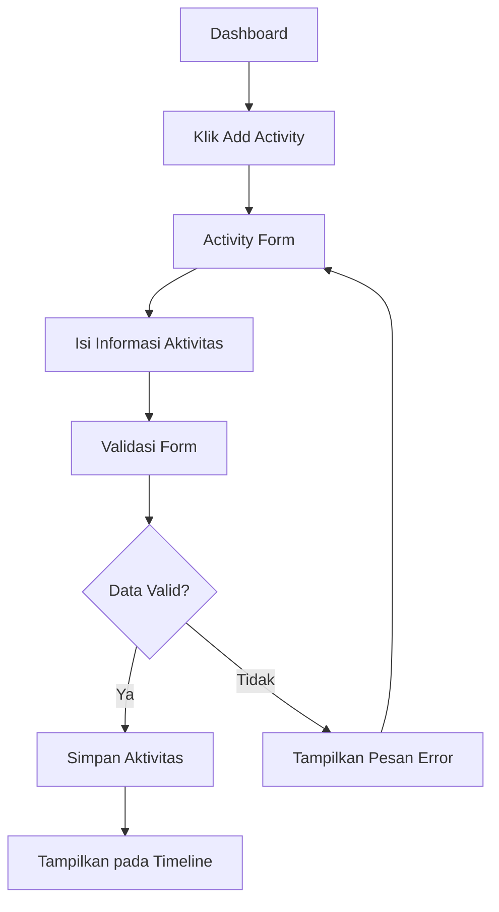
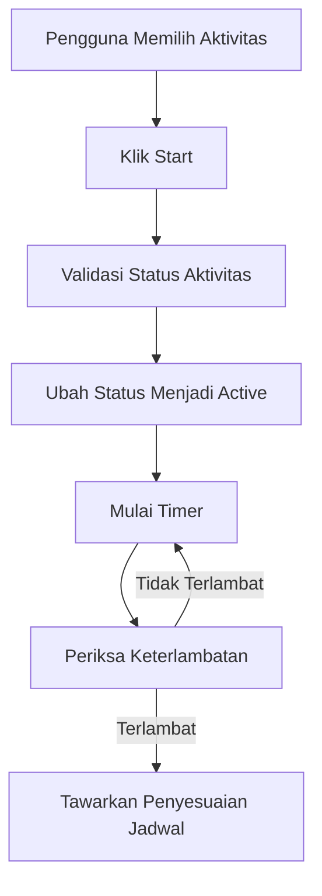
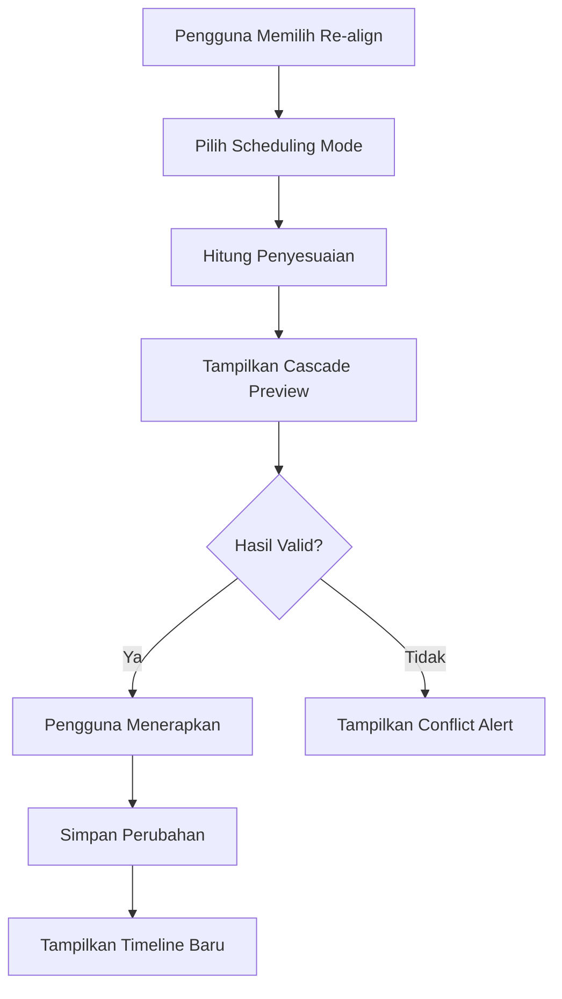

# UI/UX DESIGN DOCUMENT
# ClynSchedule
**Dynamic Time-Blocking & Smart Cascade Scheduler**

| Informasi | Detail |
|---|---|
| Nama Proyek | ClynSchedule |
| Nama Dokumen | UI/UX Design System |
| Versi Dokumen | 1.0 |
| Status | Draft |
| Bahasa | Indonesia |
| Referensi | prd.md, architecture.md |

---

# 1. DESIGN OVERVIEW

## 1.1 Tujuan Desain

Dokumen ini menjadi pedoman utama dalam merancang dan mengembangkan antarmuka pengguna ClynSchedule.

Seluruh halaman, komponen, warna, typography, layout, dan interaksi harus mengikuti standar yang ditentukan dalam dokumen ini.

Tujuannya adalah memastikan pengalaman pengguna tetap konsisten, intuitif, responsif, dan mudah digunakan selama pengembangan aplikasi.

## 1.2 Design Philosophy

ClynSchedule menggunakan pendekatan:

**Modern Productivity Dashboard**

Desain harus memberikan kesan:

- Modern.
- Minimalis.
- Profesional.
- Bersih.
- Intuitif.
- Responsif.
- Fokus pada produktivitas.

Antarmuka tidak boleh terlalu ramai dengan elemen dekoratif, animasi berlebihan, atau informasi yang tidak berkaitan langsung dengan pengelolaan jadwal.

## 1.3 Design Principles

### A. Clarity Over Complexity

Informasi jadwal harus mudah dibaca dan dipahami tanpa membutuhkan banyak interaksi.

### B. Focus on Current Activity

Aktivitas yang sedang berlangsung harus menjadi salah satu elemen paling menonjol pada dashboard.

### C. Minimal Interaction

Tindakan utama seperti Start, Complete, Skip, dan Re-align Now harus dapat diakses dengan mudah.

### D. Visual Consistency

Seluruh halaman harus menggunakan komponen, warna, typography, spacing, dan pola interaksi yang sama.

### E. Responsive First

Antarmuka harus dirancang agar nyaman digunakan melalui desktop maupun perangkat mobile.

### F. User Control

Perubahan jadwal yang dilakukan Smart Cascade harus ditampilkan secara jelas agar pengguna memahami apa yang akan berubah.

---

# 2. VISUAL DIRECTION

## 2.1 Design Style

Arah desain yang digunakan:

**Clean, Minimal, Modern, and Functional.**

Referensi karakter visual:

- Dashboard aplikasi produktivitas modern.
- Timeline berbasis waktu.
- Kartu aktivitas dengan sudut membulat.
- Sidebar navigasi sederhana.
- Warna aksen yang digunakan secara terkontrol.
- Tipografi yang jelas dan mudah dibaca.
- Bayangan lembut dan border tipis.

Hindari:

- Glassmorphism berlebihan.
- Gradient pada setiap komponen.
- Warna terlalu mencolok.
- Border yang terlalu tebal.
- Animasi yang mengganggu.
- Layout yang terlalu padat.

## 2.2 Visual Hierarchy

Urutan prioritas visual:

1. Current Activity.
2. Daily Progress.
3. Daily Timeline.
4. Next Activity.
5. Quick Actions.
6. Informasi tambahan.

Pengguna harus dapat mengetahui aktivitas yang sedang berlangsung dan aktivitas berikutnya hanya dengan melihat dashboard.

---

# 3. DESIGN SYSTEM

## 3.1 Color Palette

ClynSchedule menggunakan warna netral sebagai warna dasar dan biru sebagai warna utama.

### Primary Colors

| Token | Warna | Penggunaan |
|---|---|---|
| Primary | #2563EB | Tombol utama dan elemen interaktif |
| Primary Hover | #1D4ED8 | Kondisi hover |
| Primary Light | #DBEAFE | Background aksen |
| Primary Dark | #1E40AF | Aksen pada dark theme |

### Neutral Colors

| Token | Warna | Penggunaan |
|---|---|---|
| Background | #F8FAFC | Background halaman |
| Surface | #FFFFFF | Kartu dan panel |
| Border | #E2E8F0 | Garis pembatas |
| Text Primary | #0F172A | Teks utama |
| Text Secondary | #64748B | Teks pendukung |
| Muted | #94A3B8 | Informasi sekunder |

### Semantic Colors

| Token | Warna | Penggunaan |
|---|---|---|
| Success | #16A34A | Completed |
| Warning | #F59E0B | Delayed dan perhatian |
| Danger | #DC2626 | Error dan konflik |
| Info | #0EA5E9 | Informasi |
| Purple | #8B5CF6 | Kategori tertentu |

Warna semantic harus digunakan sesuai makna dan tidak boleh digunakan hanya sebagai dekorasi.

## 3.2 Activity Colors

Setiap kategori aktivitas memiliki warna identitas.

| Kategori | Warna |
|---|---|
| Belajar | #3B82F6 |
| Pekerjaan | #8B5CF6 |
| Karier | #F59E0B |
| Pribadi | #16A34A |
| Hiburan | #EC4899 |
| Lainnya | #64748B |

Warna kategori dapat digunakan pada:

- Activity Card.
- Timeline Indicator.
- Category Badge.
- Activity Icon.

Warna kategori harus tetap memiliki kontras yang baik terhadap background.

## 3.3 Typography

Gunakan font **Inter** sebagai typography utama.

Alternatif fallback:

```css
font-family: Inter, system-ui, sans-serif;
```

Typography scale:

| Elemen | Ukuran | Weight |
|---|---:|---|
| Page Heading | 28px | 700 |
| Section Heading | 20px | 600 |
| Card Title | 16px | 600 |
| Body | 14px | 400 |
| Secondary Text | 13px | 400 |
| Caption | 12px | 400 |
| Button | 14px | 600 |

Gunakan line-height yang cukup agar informasi mudah dibaca.

## 3.4 Spacing System

Gunakan sistem spacing berbasis kelipatan 4px.

| Token | Nilai |
|---|---:|
| XS | 4px |
| SM | 8px |
| MD | 12px |
| LG | 16px |
| XL | 20px |
| 2XL | 24px |
| 3XL | 32px |
| 4XL | 40px |
| 5XL | 48px |

Hindari penggunaan nilai spacing acak jika tidak memiliki kebutuhan desain yang jelas.

## 3.5 Border Radius

| Komponen | Radius |
|---|---:|
| Small Button | 8px |
| Input | 10px |
| Card | 12px |
| Large Card | 16px |
| Modal | 16px |
| Badge | 999px |

## 3.6 Shadow

Gunakan shadow yang lembut dan tidak berlebihan.

Contoh:

```css
--shadow-card: 0 2px 8px rgba(15, 23, 42, 0.04);
--shadow-dropdown: 0 8px 24px rgba(15, 23, 42, 0.08);
--shadow-modal: 0 16px 40px rgba(15, 23, 42, 0.12);
```

---

# 4. APPLICATION LAYOUT

## 4.1 Main Layout

Dashboard desktop menggunakan struktur:

- Sidebar.
- Top Header.
- Main Content.
- Optional Right Panel.

Struktur visual:

```text
+-------------------------------------------------------+
| Sidebar       | Header                                |
|               |---------------------------------------|
| Dashboard     |                                       |
| Schedule      | Main Content                          |
| History       |                                       |
| Settings      |  Current Activity                     |
|               |                                       |
|               |  Daily Progress                       |
|               |                                       |
|               |  Daily Timeline                       |
|               |                                       |
|               |  Next Activity                        |
|               |                                       |
+-------------------------------------------------------+
```

## 4.2 Sidebar

Sidebar digunakan sebagai navigasi utama.

Menu:

| Menu | Fungsi |
|---|---|
| Dashboard | Ringkasan aktivitas hari ini |
| Schedule | Pengelolaan jadwal |
| History | Riwayat perubahan jadwal |
| Settings | Pengaturan aplikasi |

Sidebar desktop harus dapat menggunakan mode expanded dan collapsed.

## 4.3 Header

Header berisi:

- Nama halaman.
- Tanggal hari ini.
- Informasi waktu lokal.
- Tombol tambah aktivitas.
- Notification indicator.
- Profile atau pengaturan pengguna jika autentikasi tersedia.

## 4.4 Responsive Layout

### Desktop

- Sidebar berada di sisi kiri.
- Timeline dan dashboard memiliki ruang yang cukup.
- Informasi dapat disajikan dalam beberapa kolom.
- Quick actions mudah dijangkau.

### Tablet

- Sidebar dapat berubah menjadi navigasi ringkas.
- Grid menyesuaikan lebar layar.
- Kartu aktivitas tetap mudah dibaca.

### Mobile (Web Responsive & Native Expo)

- Navigasi menggunakan bottom navigation bar (Bottom Tabs pada Expo Router).
- Konten ditampilkan dalam satu kolom vertikal yang efisien.
- Timeline menggunakan layout vertikal dengan indikator waktu real-time.
- Tombol aksi utama (Start Now, Re-align, Add) mudah dijangkau dengan ibu jari (thumb-zone friendly).
- Modal aktivitas dan Cascade Preview menggunakan bottom sheet interaktif yang dapat di-swipe atau full-screen modal.
- Safe Area terkelola baik di iOS (Dynamic Island / Notch / Home Indicator) dan Android (Edge-to-edge system bars) menggunakan `react-native-safe-area-context`.
- Respon sentuhan dilengkapi haptic feedback (`expo-haptics`) untuk konfirmasi aksi penting.

---

# 5. CORE PAGES

## 5.1 Dashboard Page

Dashboard adalah halaman utama ClynSchedule.

Tujuan:

Memberikan gambaran aktivitas harian secara cepat dan membantu pengguna mengontrol jadwal.

Komponen utama:

1. Welcome Header.
2. Date Navigation.
3. Current Activity Card.
4. Daily Progress.
5. Daily Timeline.
6. Next Activity.
7. Quick Actions.

### Current Activity Card

Menampilkan aktivitas yang sedang berlangsung.

Informasi:

- Nama aktivitas.
- Kategori.
- Waktu mulai dan selesai.
- Durasi berjalan.
- Sisa waktu.
- Progress indicator.

Tombol:

- Pause.
- Complete.
- Extend.
- Skip.

Jika belum ada aktivitas yang berjalan, tampilkan empty state dengan tombol untuk memulai aktivitas berikutnya.

### Daily Progress

Menampilkan:

- Total aktivitas.
- Aktivitas selesai.
- Aktivitas tersisa.
- Persentase penyelesaian.

Progress dihitung berdasarkan jumlah aktivitas yang telah selesai dibandingkan aktivitas yang relevan pada hari tersebut.

### Daily Timeline

Timeline menjadi komponen utama aplikasi.

Menampilkan:

- Waktu mulai dan selesai.
- Nama aktivitas.
- Durasi.
- Status.
- Jenis blok.
- Indikator Fixed Anchor.
- Indikator perubahan jadwal.

Setiap aktivitas ditampilkan sebagai Activity Card.

### Quick Actions

Tombol utama:

- Add Activity.
- Start Next.
- Re-align Now.

Re-align Now harus memiliki posisi yang mudah ditemukan, tetapi tidak boleh lebih dominan daripada tindakan utama untuk aktivitas yang sedang berlangsung.

## 5.2 Schedule Page

Halaman untuk mengelola seluruh aktivitas berdasarkan tanggal.

Fitur:

- Melihat jadwal berdasarkan tanggal.
- Menambahkan aktivitas.
- Mengedit aktivitas.
- Menghapus aktivitas.
- Mengatur kategori.
- Mengatur waktu dan durasi.
- Mengatur Flexible atau Fixed Anchor.
- Memilih mode penyesuaian jadwal.

## 5.3 History Page

Menampilkan riwayat perubahan jadwal.

Setiap item riwayat menampilkan:

- Jenis perubahan.
- Waktu perubahan.
- Aktivitas yang terdampak.
- Jadwal sebelum perubahan.
- Jadwal sesudah perubahan.
- Tombol Undo jika masih memungkinkan.

## 5.4 Settings Page

Pengaturan meliputi:

- Theme: Light / Dark.
- Timezone.
- Default Scheduling Mode.
- Reminder Preferences.
- Sound Preferences.
- Notification Permission.
- Pengaturan waktu harian.

Pengaturan yang belum tersedia pada MVP tidak perlu ditampilkan sebagai fitur aktif.

---

# 6. COMPONENT DESIGN

## 6.1 Button

Jenis tombol:

| Variant | Penggunaan |
|---|---|
| Primary | Aksi utama |
| Secondary | Aksi alternatif |
| Outline | Aksi sekunder |
| Ghost | Aksi ringan |
| Danger | Penghapusan atau tindakan berisiko |

Aturan:

- Setiap tombol harus memiliki label yang jelas.
- Gunakan ikon jika membantu pemahaman.
- Tampilkan loading state ketika proses berlangsung.
- Tombol disabled harus memiliki tampilan berbeda.
- Hindari penggunaan tombol dengan fungsi yang tidak jelas.

## 6.2 Activity Card

Activity Card merupakan komponen utama pada timeline.

Informasi yang ditampilkan:

- Nama aktivitas.
- Waktu mulai dan selesai.
- Durasi.
- Kategori.
- Status.
- Fixed Anchor indicator.
- Changed indicator.

Variasi tampilan:

**Pending**
- Tampilan normal.
- Menampilkan tombol Start.

**Active**
- Memiliki highlight yang jelas.
- Menampilkan timer.
- Menampilkan kontrol aktivitas.

**Completed**
- Menggunakan indikator hijau.
- Menampilkan status selesai.

**Skipped**
- Menggunakan tampilan muted.
- Menampilkan status dilewati.

**Fixed Anchor**
- Menampilkan ikon lock.
- Menampilkan informasi bahwa waktu tidak dapat digeser otomatis.

## 6.3 Activity Form

Form digunakan untuk membuat atau mengubah aktivitas.

Field:

| Field | Jenis |
|---|---|
| Activity Name | Text Input |
| Category | Select |
| Date | Date Picker |
| Start Time | Time Input |
| Duration | Number Input |
| Minimum Duration | Number Input |
| Block Type | Radio / Segmented Control |
| Allow Compression | Toggle |
| Priority | Select |

Aturan interaksi:

- End Time dihitung berdasarkan Start Time dan Duration.
- Jika Fixed Anchor dipilih, waktu mulai dan selesai menjadi waktu yang dilindungi.
- Jika Compress Duration tidak diaktifkan, Minimum Duration tidak boleh digunakan untuk mengubah durasi secara otomatis.
- Validasi harus ditampilkan dekat dengan field terkait.

## 6.4 Schedule Mode Selector

Digunakan untuk memilih:

**Ripple Shift**

Menggeser aktivitas fleksibel berikutnya tanpa mengurangi durasinya.

**Compress Duration**

Mengurangi durasi aktivitas fleksibel sesuai batas minimum untuk mempertahankan target waktu selesai sejauh memungkinkan.

Pilihan mode harus disertai deskripsi singkat agar pengguna memahami konsekuensinya.

## 6.5 Cascade Preview

Komponen penting yang muncul sebelum perubahan jadwal diterapkan.

Menampilkan:

- Jadwal sebelum.
- Jadwal sesudah.
- Aktivitas yang berubah.
- Durasi yang dikompresi.
- Aktivitas yang dilindungi.
- Konflik yang ditemukan.

Tombol:

- Apply Changes.
- Cancel.

Jika terjadi konflik yang belum terselesaikan, tombol Apply Changes harus dinonaktifkan.

## 6.6 Conflict Alert

Digunakan untuk menampilkan:

- Benturan jadwal.
- Durasi minimum tercapai.
- Waktu melebihi batas akhir hari.
- Fixed Anchor collision.
- Penyesuaian yang tidak dapat dilakukan.

Pesan harus menggunakan bahasa yang mudah dipahami dan menjelaskan penyebab serta dampaknya.

---

# 7. USER EXPERIENCE FLOW

## 7.1 Create Activity Flow



## 7.2 Start Activity Flow



## 7.3 Smart Cascade Flow



## 7.4 Complete Early Flow

1. Pengguna menyelesaikan aktivitas sebelum waktu yang direncanakan.
2. Pengguna menekan Complete.
3. Sistem mencatat waktu selesai aktual.
4. Sistem menghitung waktu yang tersedia.
5. Sistem menawarkan penyesuaian aktivitas berikutnya.
6. Pengguna dapat menyetujui atau mengabaikan penyesuaian.

---

# 8. INTERACTION DESIGN

## 8.1 Interaction States

Setiap komponen interaktif harus mendukung state berikut jika relevan:

- Default.
- Hover.
- Focus.
- Active.
- Disabled.
- Loading.
- Error.
- Success.

## 8.2 Modal and Dialog

Modal digunakan untuk:

- Menambah aktivitas.
- Mengedit aktivitas.
- Konfirmasi penghapusan.
- Preview Smart Cascade.
- Konfirmasi Undo.

Aturan:

- Modal memiliki judul yang jelas.
- Fokus keyboard harus tetap terkelola.
- Tombol Cancel dan Confirm harus mudah ditemukan.
- Klik di luar modal tidak boleh menyebabkan perubahan penting secara tidak sengaja.

## 8.3 Toast Notifications

Toast digunakan untuk informasi singkat:

- Aktivitas berhasil dibuat.
- Aktivitas berhasil diperbarui.
- Jadwal berhasil disesuaikan.
- Perubahan berhasil dibatalkan.
- Terjadi kesalahan penyimpanan.

Toast tidak boleh menggantikan informasi konflik yang membutuhkan tindakan pengguna.

## 8.4 Micro-interactions

Animasi diperbolehkan untuk:

- Perubahan status aktivitas.
- Pergerakan timeline.
- Pembukaan modal.
- Progress indicator.
- Tombol interaksi.
- Feedback setelah tindakan berhasil.

Gunakan transisi yang ringan dan singkat.

Hindari animasi yang menghambat pengguna ketika melakukan tindakan berulang.

---

# 9. RESPONSIVE DESIGN

## 9.1 Breakpoints

Gunakan breakpoint Tailwind CSS:

| Device | Breakpoint |
|---|---|
| Mobile | < 640px |
| Tablet | 640px–1023px |
| Desktop | >= 1024px |
| Large Desktop | >= 1280px |

## 9.2 Mobile Guidelines (Web PWA & Native Expo)

- Gunakan layout satu kolom vertikal yang bersih.
- Bottom navigation (Bottom Tabs pada Expo Router) sebagai navigasi utama antar fitur.
- Activity Card harus memiliki target sentuh yang nyaman (minimum 44x44 pt).
- Gunakan ukuran tombol yang proporsional dan mudah ditekan dengan satu tangan.
- Hindari tabel lebar atau horizontal scroll yang tidak disengaja.
- Cascade Preview harus dapat dibaca dan dievaluasi tanpa horizontal scrolling.
- Modal formulir aktivitas menggunakan bottom sheet yang dapat digeser atau full-screen modal.
- Integrasikan Pull-to-Refresh (`RefreshControl` di Expo) pada Timeline dan Dashboard untuk memuat ulang jadwal.
- Terapkan getaran haptic halus (`expo-haptics`) ketika status aktivitas berganti (Start/Complete/Skip/Re-align).

## 9.3 Desktop Guidelines

- Gunakan sidebar.
- Maksimalkan ruang timeline.
- Gunakan multi-column layout jika diperlukan.
- Pertahankan jarak antarbagian.
- Jangan memperlebar teks secara berlebihan.

---

# 10. ACCESSIBILITY

Seluruh antarmuka harus memperhatikan aksesibilitas.

Ketentuan:

1. Gunakan kontras warna yang memadai.
2. Jangan menggunakan warna sebagai satu-satunya penanda status.
3. Sediakan label pada input.
4. Sediakan alternatif teks untuk ikon yang memiliki fungsi.
5. Semua kontrol penting dapat digunakan dengan keyboard.
6. Fokus keyboard harus terlihat.
7. Ukuran area interaksi harus nyaman pada perangkat sentuh.
8. Hormati preferensi reduced motion.
9. Gunakan struktur heading yang teratur.
10. Gunakan pesan validasi yang dapat dipahami.

---

# 11. LIGHT & DARK MODE

ClynSchedule harus memiliki fondasi untuk mendukung Light dan Dark Mode.

Light Mode menjadi tema default MVP.

Dark Mode dapat diimplementasikan setelah sistem warna dan komponen utama stabil.

Aturan:

- Warna teks harus tetap memiliki kontras.
- Warna status harus tetap dapat dibedakan.
- Border dan surface harus menyesuaikan tema.
- Jangan menggunakan warna hardcoded langsung di banyak komponen.
- Gunakan design tokens agar tema dapat diubah secara konsisten.

---

# 12. DESIGN TOKENS

Gunakan CSS variables untuk menjaga konsistensi.

Contoh implementasi:

```css
:root {
  --color-primary: #2563EB;
  --color-primary-hover: #1D4ED8;

  --color-background: #F8FAFC;
  --color-surface: #FFFFFF;
  --color-border: #E2E8F0;

  --color-text-primary: #0F172A;
  --color-text-secondary: #64748B;

  --color-success: #16A34A;
  --color-warning: #F59E0B;
  --color-danger: #DC2626;

  --radius-card: 12px;
  --radius-modal: 16px;

  --shadow-card:
    0 2px 8px rgba(15, 23, 42, 0.04);
}
```

Komponen harus menggunakan token tersebut, bukan mendefinisikan ulang nilai visual yang sama secara sembarangan.

---

# 13. EMPTY, LOADING & ERROR STATES

## 13.1 Empty State

Ketika pengguna belum memiliki aktivitas:

- Tampilkan ilustrasi atau ikon sederhana.
- Tampilkan pesan singkat.
- Tampilkan tombol Add Activity.

Contoh pesan:

"Belum ada aktivitas untuk hari ini. Mulai susun jadwal harianmu."

## 13.2 Loading State

Gunakan:

- Skeleton Card.
- Loading Indicator.
- Disabled Button ketika request sedang diproses.

Hindari menampilkan halaman kosong ketika data sedang dimuat.

## 13.3 Error State

Tampilkan pesan yang menjelaskan:

- Apa yang gagal.
- Mengapa tindakan gagal jika diketahui.
- Apa yang dapat dilakukan pengguna selanjutnya.

Jangan menampilkan pesan teknis backend secara langsung kepada pengguna umum.

---

# 14. DESIGN CONSTRAINTS

Seluruh implementasi UI harus mengikuti aturan berikut:

1. Jangan membuat design system baru untuk setiap halaman.
2. Jangan menggunakan warna di luar design tokens tanpa alasan.
3. Jangan menggunakan typography yang berbeda tanpa kebutuhan desain.
4. Jangan membuat komponen yang sama dengan implementasi visual berbeda.
5. Jangan menambahkan animasi berlebihan.
6. Jangan membuat dashboard terlalu padat.
7. Jangan menyembunyikan fungsi Smart Cascade di menu yang sulit ditemukan.
8. Jangan membuat Fixed Anchor sulit dibedakan dari aktivitas fleksibel.
9. Jangan menggunakan ikon tanpa fungsi yang jelas.
10. Jangan mengorbankan usability hanya demi tampilan visual.

---

# 15. DESIGN ACCEPTANCE CRITERIA

Desain ClynSchedule dianggap memenuhi standar apabila:

- Dashboard dapat menampilkan aktivitas harian dengan jelas.
- Current Activity mudah dikenali.
- Daily Timeline mudah dipahami.
- Aktivitas Fixed Anchor memiliki indikator yang jelas.
- Status aktivitas dapat dibedakan.
- Pengguna dapat membuat dan mengedit aktivitas dengan mudah.
- Cascade Preview dapat memperlihatkan perubahan jadwal.
- Konflik jadwal dapat dipahami pengguna.
- Tampilan responsif pada desktop, tablet, dan mobile.
- Komponen menggunakan design tokens.
- Interaksi memiliki feedback visual yang jelas.
- Navigasi konsisten pada seluruh halaman.

---

# 16. FINAL DESIGN DEFINITION

ClynSchedule menggunakan desain Modern Productivity Dashboard dengan pendekatan minimalis, profesional, dan berorientasi pada kemudahan penggunaan.

Antarmuka berpusat pada Daily Timeline, Current Activity, dan Smart Cascade Controls.

Warna utama menggunakan biru dengan kombinasi warna netral, sementara warna semantic digunakan untuk menunjukkan status aktivitas dan konflik jadwal.

Seluruh komponen harus responsif, reusable, dan mengikuti design system yang telah ditentukan.

**Design Principle:**

"Less clutter. More clarity. Better control of your time."

---

**END OF DOCUMENT — ClynSchedule Design v1.0**