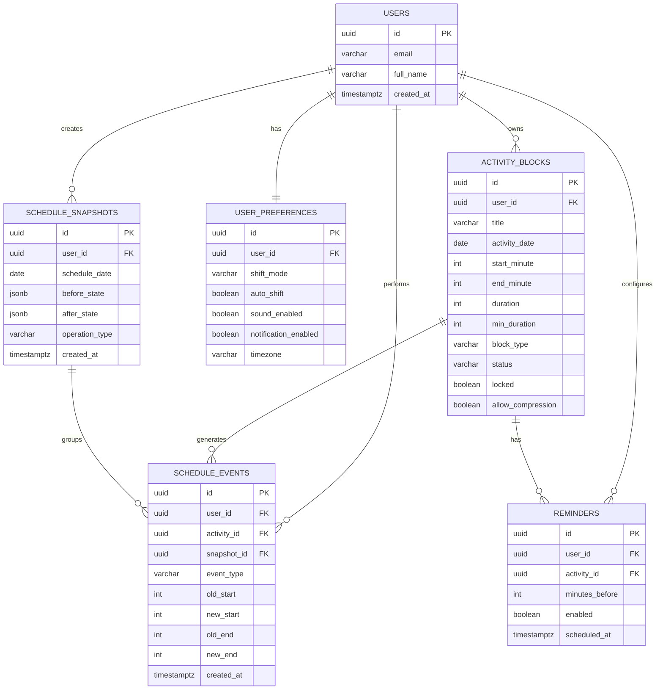

# ClynSchedule — Database Schema

## 1. Overview

Dokumen ini menjelaskan rancangan database untuk **ClynSchedule**, aplikasi Dynamic Time-Blocking & Smart Cascade Scheduler yang membantu pengguna mengelola aktivitas harian secara dinamis.

Database dirancang menggunakan **PostgreSQL** dengan pendekatan relasional untuk memastikan konsistensi data, integritas jadwal, dan kemampuan pencatatan perubahan aktivitas.

### Tujuan Database

- Menyimpan aktivitas dan jadwal harian pengguna.
- Membedakan aktivitas fleksibel dan aktivitas tetap (*Fixed Anchor*).
- Mendukung perubahan jadwal menggunakan Ripple Shift dan Compress Duration.
- Menyimpan riwayat perubahan jadwal untuk kebutuhan Undo.
- Mengelola preferensi pengguna dan pengaturan notifikasi.
- Mendukung sinkronisasi data dan pengembangan fitur di masa mendatang.

### Database Technology

| Komponen | Teknologi |
|---|---|
| Database | PostgreSQL |
| ORM | Prisma ORM |
| Backend | Node.js + Express.js + TypeScript |
| Validation | Zod |
| Migration | Prisma Migrate |
| Primary Key | UUID |
| Default Timezone | Asia/Makassar |

---

## 2. Database Design Principles

Database ClynSchedule mengikuti prinsip berikut:

1. **Data Integrity:** setiap aktivitas harus memiliki data waktu dan status yang valid.
2. **User Ownership:** setiap data aktivitas dimiliki oleh pengguna tertentu.
3. **Anchor Protection:** aktivitas Fixed Anchor tidak boleh berubah waktu secara otomatis.
4. **Schedule History:** setiap perubahan jadwal penting harus dapat dilacak.
5. **Flexible Scheduling:** aktivitas fleksibel dapat digeser atau dikompresi sesuai aturan.
6. **Offline Support:** data dapat disimpan sementara di IndexedDB sebelum disinkronkan dengan backend.
7. **Scalability:** struktur database harus memungkinkan penambahan fitur tanpa perubahan besar pada tabel inti.

---

## 3. Database Entity Relationship

Database utama terdiri dari enam entitas:

| Entity | Fungsi |
|---|---|
| `users` | Menyimpan informasi pengguna |
| `activity_blocks` | Menyimpan aktivitas dan jadwal |
| `schedule_events` | Mencatat perubahan jadwal |
| `schedule_snapshots` | Menyimpan kondisi jadwal sebelum dan sesudah perubahan |
| `user_preferences` | Menyimpan preferensi pengguna |
| `reminders` | Menyimpan pengaturan pengingat aktivitas |

### Entity Relationship Diagram



---

## 4. Table Structures

### 4.1. `users`

Menyimpan informasi dasar pengguna aplikasi.

| Column | Data Type | Constraint | Description |
|---|---|---|---|
| `id` | UUID | PK | ID unik pengguna |
| `email` | VARCHAR(255) | UNIQUE, NOT NULL | Email pengguna |
| `full_name` | VARCHAR(150) | NULL | Nama pengguna |
| `password_hash` | TEXT | NULL | Password hash jika autentikasi dikelola sendiri |
| `created_at` | TIMESTAMPTZ | NOT NULL | Waktu pembuatan akun |
| `updated_at` | TIMESTAMPTZ | NOT NULL | Waktu pembaruan data |

**Catatan:** Jika menggunakan Supabase Auth, identitas pengguna sebaiknya menggunakan UUID dari `auth.users`. Jangan menyimpan password mentah di database aplikasi.

### 4.2. `activity_blocks`

Tabel utama yang menyimpan seluruh aktivitas pengguna.

| Column | Data Type | Constraint | Description |
|---|---|---|---|
| `id` | UUID | PK | ID unik aktivitas |
| `user_id` | UUID | FK, NOT NULL | Pemilik aktivitas |
| `title` | VARCHAR(200) | NOT NULL | Nama aktivitas |
| `description` | TEXT | NULL | Deskripsi aktivitas |
| `category` | VARCHAR(50) | NOT NULL | Kategori aktivitas |
| `activity_date` | DATE | NOT NULL | Tanggal aktivitas |
| `start_minute` | SMALLINT | NOT NULL | Waktu mulai dalam menit dari 00:00 |
| `end_minute` | SMALLINT | NOT NULL | Waktu selesai dalam menit dari 00:00 |
| `duration` | SMALLINT | NOT NULL | Durasi terencana dalam menit |
| `min_duration` | SMALLINT | NOT NULL | Durasi minimum aktivitas |
| `block_type` | VARCHAR(20) | NOT NULL | `flexible` atau `fixed` |
| `status` | VARCHAR(20) | NOT NULL | Status aktivitas |
| `locked` | BOOLEAN | NOT NULL DEFAULT FALSE | Mengunci aktivitas dari perubahan otomatis |
| `allow_compression` | BOOLEAN | NOT NULL DEFAULT TRUE | Mengizinkan pemangkasan durasi |
| `priority` | SMALLINT | NOT NULL DEFAULT 3 | Prioritas aktivitas, skala 1–5 |
| `color` | VARCHAR(20) | NULL | Warna tampilan aktivitas |
| `actual_start` | TIMESTAMPTZ | NULL | Waktu mulai aktual |
| `actual_end` | TIMESTAMPTZ | NULL | Waktu selesai aktual |
| `created_at` | TIMESTAMPTZ | NOT NULL | Waktu pembuatan |
| `updated_at` | TIMESTAMPTZ | NOT NULL | Waktu pembaruan |
| `version` | INTEGER | NOT NULL DEFAULT 1 | Versi data untuk optimistic concurrency |

**Aturan penting:**

- `start_minute` dan `end_minute` menggunakan rentang 0–1440.
- `duration` harus sama dengan `end_minute - start_minute`.
- `min_duration` tidak boleh lebih besar dari `duration`.
- Aktivitas `fixed` tidak boleh digeser atau dikompresi oleh Smart Cascade Engine.
- Aktivitas dengan `locked = true` tidak boleh diubah otomatis.
- Aktivitas `completed` dan `skipped` tidak boleh ikut digeser oleh proses cascade.
- `actual_start` dan `actual_end` menyimpan waktu aktual, terpisah dari jadwal rencana.

### 4.3. `schedule_events`

Mencatat setiap perubahan yang terjadi pada aktivitas.

| Column | Data Type | Constraint | Description |
|---|---|---|---|
| `id` | UUID | PK | ID unik event |
| `user_id` | UUID | FK, NOT NULL | Pemilik event |
| `activity_id` | UUID | FK, NULL | Aktivitas terkait |
| `snapshot_id` | UUID | FK, NULL | Snapshot perubahan terkait |
| `event_type` | VARCHAR(30) | NOT NULL | Jenis perubahan |
| `old_start` | SMALLINT | NULL | Waktu mulai sebelumnya |
| `new_start` | SMALLINT | NULL | Waktu mulai setelah perubahan |
| `old_end` | SMALLINT | NULL | Waktu selesai sebelumnya |
| `new_end` | SMALLINT | NULL | Waktu selesai setelah perubahan |
| `old_duration` | SMALLINT | NULL | Durasi sebelumnya |
| `new_duration` | SMALLINT | NULL | Durasi setelah perubahan |
| `metadata` | JSONB | NULL | Informasi tambahan |
| `created_at` | TIMESTAMPTZ | NOT NULL | Waktu event |

Contoh nilai `event_type`:

- `activity_created`
- `activity_updated`
- `activity_started`
- `activity_completed`
- `activity_skipped`
- `schedule_shifted`
- `duration_compressed`
- `schedule_realigned`
- `schedule_undone`

Event yang termasuk dalam satu operasi cascade harus memiliki referensi `snapshot_id` yang sama.

### 4.4. `schedule_snapshots`

Menyimpan kondisi jadwal sebelum dan sesudah suatu operasi agar sistem dapat melakukan Undo.

| Column | Data Type | Constraint | Description |
|---|---|---|---|
| `id` | UUID | PK | ID unik snapshot |
| `user_id` | UUID | FK, NOT NULL | Pemilik snapshot |
| `schedule_date` | DATE | NOT NULL | Tanggal jadwal |
| `operation_type` | VARCHAR(30) | NOT NULL | Jenis operasi |
| `before_state` | JSONB | NOT NULL | Kondisi jadwal sebelum perubahan |
| `after_state` | JSONB | NOT NULL | Kondisi jadwal setelah perubahan |
| `is_undone` | BOOLEAN | NOT NULL DEFAULT FALSE | Status Undo |
| `created_at` | TIMESTAMPTZ | NOT NULL | Waktu pembuatan snapshot |
| `undone_at` | TIMESTAMPTZ | NULL | Waktu Undo dilakukan |

Nilai `operation_type`:

- `ripple_shift`
- `compress_duration`
- `re_align`
- `manual_update`
- `skip_activity`

**Ketentuan:**

- Snapshot dibuat sebelum perubahan jadwal diterapkan.
- `before_state` dan `after_state` harus mencakup seluruh data aktivitas yang terdampak.
- Undo harus memeriksa versi data agar tidak menimpa perubahan yang lebih baru.
- Snapshot tidak boleh dihapus sebelum melewati kebijakan retensi riwayat yang ditentukan.

### 4.5. `user_preferences`

Menyimpan pengaturan dan preferensi pengguna.

| Column | Data Type | Constraint | Description |
|---|---|---|---|
| `id` | UUID | PK | ID unik preferensi |
| `user_id` | UUID | FK, UNIQUE, NOT NULL | Pemilik preferensi |
| `shift_mode` | VARCHAR(30) | NOT NULL DEFAULT `ripple_shift` | Mode cascade |
| `auto_shift` | BOOLEAN | NOT NULL DEFAULT FALSE | Mengaktifkan penyesuaian otomatis |
| `sound_enabled` | BOOLEAN | NOT NULL DEFAULT TRUE | Suara notifikasi |
| `notification_enabled` | BOOLEAN | NOT NULL DEFAULT TRUE | Notifikasi aktif |
| `timezone` | VARCHAR(50) | NOT NULL DEFAULT `Asia/Makassar` | Zona waktu pengguna |
| `theme` | VARCHAR(20) | NOT NULL DEFAULT `light` | Tema aplikasi |
| `created_at` | TIMESTAMPTZ | NOT NULL | Waktu pembuatan |
| `updated_at` | TIMESTAMPTZ | NOT NULL | Waktu pembaruan |

Nilai `shift_mode`:

- `ripple_shift`
- `compress_duration`

Nilai `theme`:

- `light`
- `dark`
- `system`

### 4.6. `reminders`

Menyimpan konfigurasi pengingat untuk setiap aktivitas.

| Column | Data Type | Constraint | Description |
|---|---|---|---|
| `id` | UUID | PK | ID unik reminder |
| `user_id` | UUID | FK, NOT NULL | Pemilik reminder |
| `activity_id` | UUID | FK, NOT NULL | Aktivitas terkait |
| `minutes_before` | SMALLINT | NOT NULL DEFAULT 5 | Waktu pengingat sebelum aktivitas |
| `enabled` | BOOLEAN | NOT NULL DEFAULT TRUE | Status reminder |
| `scheduled_at` | TIMESTAMPTZ | NULL | Waktu pengiriman yang direncanakan |
| `delivered_at` | TIMESTAMPTZ | NULL | Waktu notifikasi terkirim |
| `created_at` | TIMESTAMPTZ | NOT NULL | Waktu pembuatan |
| `updated_at` | TIMESTAMPTZ | NOT NULL | Waktu pembaruan |

Satu aktivitas dapat memiliki lebih dari satu reminder, misalnya pengingat 15 menit dan 5 menit sebelum dimulai.

---

## 5. Enum and Allowed Values

Untuk menjaga konsistensi, nilai berikut harus dibatasi menggunakan PostgreSQL ENUM atau validasi Zod pada backend.

### Activity Status

| Value | Description |
|---|---|
| `pending` | Aktivitas belum dimulai |
| `active` | Aktivitas sedang berlangsung |
| `completed` | Aktivitas selesai |
| `skipped` | Aktivitas dilewati |

### Block Type

| Value | Description |
|---|---|
| `flexible` | Aktivitas dapat digeser sesuai aturan cascade |
| `fixed` | Aktivitas tetap dan dilindungi dari perubahan otomatis |

### Cascade Mode

| Value | Description |
|---|---|
| `ripple_shift` | Menggeser aktivitas fleksibel berikutnya |
| `compress_duration` | Mengurangi durasi aktivitas fleksibel sesuai batas minimum |

### Event Type

| Value | Description |
|---|---|
| `activity_created` | Aktivitas dibuat |
| `activity_updated` | Aktivitas diperbarui |
| `activity_started` | Aktivitas dimulai |
| `activity_completed` | Aktivitas diselesaikan |
| `activity_skipped` | Aktivitas dilewati |
| `schedule_shifted` | Jadwal digeser |
| `duration_compressed` | Durasi dikompresi |
| `schedule_realigned` | Jadwal diselaraskan ulang |
| `schedule_undone` | Perubahan dibatalkan |

---

## 6. Database Constraints

Constraint digunakan untuk memastikan data yang tersimpan tetap valid.

### 6.1. Activity Constraints

| Constraint | Rule |
|---|---|
| Primary Key | Setiap aktivitas memiliki UUID unik |
| Foreign Key | `user_id` harus mengarah ke pengguna yang valid |
| Required Fields | `title`, `activity_date`, `start_minute`, `end_minute` wajib diisi |
| Valid Start | `start_minute >= 0` dan `start_minute < 1440` |
| Valid End | `end_minute > start_minute` dan `end_minute <= 1440` |
| Valid Duration | `duration = end_minute - start_minute` |
| Minimum Duration | `min_duration > 0` dan `min_duration <= duration` |
| Valid Priority | `priority` berada pada rentang 1–5 |
| Valid Status | Status harus sesuai daftar yang diizinkan |
| Valid Block Type | Hanya `flexible` atau `fixed` |

### 6.2. Schedule Constraints

1. Aktivitas pada tanggal yang sama tidak boleh bertabrakan, kecuali aplikasi nantinya mendukung aktivitas paralel secara eksplisit.
2. Aktivitas Fixed Anchor harus mempertahankan waktu mulai dan selesai yang telah ditentukan.
3. Aktivitas yang telah selesai tidak boleh digeser oleh cascade.
4. Durasi aktivitas tidak boleh lebih kecil dari `min_duration`.
5. Operasi cascade harus dibatalkan jika menghasilkan konflik yang tidak dapat diselesaikan.
6. Semua perubahan dalam satu operasi cascade harus disimpan secara atomik menggunakan database transaction.

**Catatan:** Pemeriksaan bentrok jadwal sebaiknya dilakukan oleh Scheduling Engine dalam transaksi backend, bukan hanya mengandalkan constraint database.

---

## 7. Indexing Strategy

Index digunakan untuk meningkatkan performa pencarian aktivitas dan jadwal.

| Index | Table | Columns | Purpose |
|---|---|---|---|
| `idx_activity_user_date` | `activity_blocks` | `user_id`, `activity_date` | Mengambil jadwal harian pengguna |
| `idx_activity_date_time` | `activity_blocks` | `activity_date`, `start_minute` | Mengurutkan aktivitas berdasarkan waktu |
| `idx_activity_status` | `activity_blocks` | `user_id`, `status` | Memfilter status aktivitas |
| `idx_events_user_created` | `schedule_events` | `user_id`, `created_at` | Mengambil riwayat perubahan |
| `idx_snapshots_user_date` | `schedule_snapshots` | `user_id`, `schedule_date` | Mengambil snapshot berdasarkan tanggal |
| `idx_reminders_scheduled` | `reminders` | `scheduled_at`, `enabled` | Mencari reminder yang perlu diproses |

Index tambahan dapat dibuat berdasarkan hasil pengujian performa ketika jumlah data meningkat.

---

## 8. Data Relationships and Delete Rules

| Relationship | Rule |
|---|---|
| User → Activity Blocks | Satu pengguna memiliki banyak aktivitas |
| User → Preferences | Satu pengguna memiliki satu preferensi |
| User → Schedule Events | Satu pengguna memiliki banyak event |
| User → Schedule Snapshots | Satu pengguna memiliki banyak snapshot |
| Activity → Reminders | Satu aktivitas dapat memiliki banyak reminder |
| Activity → Schedule Events | Satu aktivitas dapat memiliki banyak event |

Rekomendasi penghapusan:

- Penghapusan akun dapat menggunakan `ON DELETE CASCADE` setelah proses penghapusan data pengguna dijalankan sesuai kebijakan privasi.
- Penghapusan aktivitas sebaiknya menggunakan soft delete melalui kolom `deleted_at` jika riwayat aktivitas perlu dipertahankan.
- Penghapusan snapshot dan event harus mengikuti kebijakan retensi riwayat.
- Jangan menghapus snapshot yang masih dibutuhkan untuk proses Undo.

---

## 9. Time and Timezone Management

ClynSchedule menggunakan pendekatan **minute-of-day** untuk perhitungan jadwal harian.

Contoh:

| Time | Minute Value |
|---|---:|
| 06:00 | 360 |
| 07:30 | 450 |
| 08:00 | 480 |
| 12:00 | 720 |
| 15:30 | 930 |
| 21:00 | 1260 |
| 23:59 | 1439 |

Aturan penyimpanan waktu:

1. `start_minute` dan `end_minute` digunakan oleh Smart Cascade Engine untuk perhitungan jadwal harian.
2. `activity_date` menentukan tanggal aktivitas.
3. Timestamp aktual disimpan menggunakan `TIMESTAMPTZ`.
4. Zona waktu pengguna disimpan pada `user_preferences.timezone`.
5. Backend harus mengonversi waktu lokal pengguna dengan benar ketika membuat timestamp.
6. Aktivitas yang melewati tengah malam belum termasuk MVP dan memerlukan model penjadwalan lintas tanggal jika nantinya didukung.

---

## 10. Smart Cascade Data Rules

Database harus mendukung dua metode utama penyesuaian jadwal.

### 10.1. Ripple Shift

Ketika suatu aktivitas mengalami keterlambatan, aktivitas fleksibel berikutnya dapat digeser berdasarkan selisih waktu.

Contoh:

| Activity | Before | After |
|---|---|---|
| Belajar CPNS | 08:00–09:00 | 08:30–09:30 |
| Coding Project | 09:00–11:00 | 09:30–11:30 |
| Cari Lowongan | 11:00–12:00 | 11:30–12:30 |

Perubahan disimpan pada `schedule_events` dan kondisi jadwal sebelum serta sesudah operasi disimpan pada `schedule_snapshots`.

### 10.2. Compress Duration

Ketika waktu perlu dihemat, sistem dapat mengurangi durasi aktivitas fleksibel tanpa melewati batas `min_duration`.

Contoh:

| Activity | Before | After |
|---|---|---|
| Belajar CPNS | 08:00–09:00 | 08:00–08:45 |
| Coding Project | 09:00–11:00 | 08:45–10:15 |
| Cari Lowongan | 11:00–12:00 | 10:15–11:00 |

Kompresi hanya boleh dilakukan jika `allow_compression = true` dan durasi setelah perubahan tidak lebih kecil dari `min_duration`.

### 10.3. Fixed Anchor Protection

Aktivitas seperti ibadah, janji temu, dan tidur dapat ditandai sebagai `fixed`.

Ketentuannya:

- Waktu aktivitas tidak boleh berubah otomatis.
- Aktivitas fleksibel sebelum dan sesudah anchor dapat disesuaikan secara terpisah.
- Jika tidak ada ruang untuk menyesuaikan aktivitas tanpa melanggar anchor, sistem harus menghasilkan konflik.
- Sistem tidak boleh diam-diam memindahkan atau mengurangi durasi Fixed Anchor.

---

## 11. Transaction and Concurrency Rules

Setiap perubahan jadwal harus diproses secara aman.

### Transaction Flow

1. Backend mengambil aktivitas yang relevan.
2. Backend memvalidasi jadwal dan versi data.
3. Backend membuat snapshot kondisi awal.
4. Smart Cascade Engine menghitung perubahan.
5. Conflict Detector memeriksa hasil perhitungan.
6. Jika valid, backend memperbarui aktivitas dan menyimpan event.
7. Backend menyimpan kondisi akhir ke snapshot.
8. Semua perubahan di-commit dalam satu transaksi.

Jika terjadi konflik atau kesalahan, seluruh perubahan harus di-rollback.

### Optimistic Concurrency

Kolom `version` pada `activity_blocks` digunakan untuk mencegah perubahan yang menimpa data terbaru.

Contoh:

- Client membaca aktivitas dengan `version = 1`.
- Client mengirim pembaruan dengan versi yang sama.
- Backend memeriksa apakah versi database masih `1`.
- Jika cocok, data diperbarui dan versi menjadi `2`.
- Jika tidak cocok, backend mengembalikan konflik agar client mengambil data terbaru.

---

## 12. Prisma Model Reference

Contoh representasi awal model menggunakan Prisma ORM:

```prisma
enum ActivityStatus {
  pending
  active
  completed
  skipped
}

enum BlockType {
  flexible
  fixed
}

enum CascadeMode {
  ripple_shift
  compress_duration
}

model ActivityBlock {
  id               String         @id @default(uuid()) @db.Uuid
  userId           String         @map("user_id") @db.Uuid
  title            String         @db.VarChar(200)
  description      String?
  category         String         @db.VarChar(50)
  activityDate     DateTime       @map("activity_date") @db.Date
  startMinute      Int            @map("start_minute") @db.SmallInt
  endMinute        Int            @map("end_minute") @db.SmallInt
  duration         Int            @db.SmallInt
  minDuration      Int            @map("min_duration") @db.SmallInt
  blockType        BlockType      @default(flexible) @map("block_type")
  status           ActivityStatus @default(pending)
  locked           Boolean        @default(false)
  allowCompression Boolean        @default(true) @map("allow_compression")
  priority         Int            @default(3) @db.SmallInt
  color            String?        @db.VarChar(20)
  actualStart      DateTime?      @map("actual_start") @db.Timestamptz
  actualEnd        DateTime?      @map("actual_end") @db.Timestamptz
  version          Int            @default(1)
  createdAt        DateTime       @default(now()) @map("created_at") @db.Timestamptz
  updatedAt        DateTime       @updatedAt @map("updated_at") @db.Timestamptz

  @@index([userId, activityDate], map: "idx_activity_user_date")
  @@index([activityDate, startMinute], map: "idx_activity_date_time")
  @@index([userId, status], map: "idx_activity_status")
  @@map("activity_blocks")
}
```

Model di atas merupakan contoh awal untuk tabel aktivitas. Model pengguna, preferensi, event, snapshot, dan reminder harus ditambahkan sebelum implementasi database lengkap.

---

## 13. Seed Data

Data awal berikut digunakan untuk pengujian dan demonstrasi aplikasi.

| Activity | Category | Start | End | Duration | Min Duration | Block Type |
|---|---|---|---|---:|---:|---|
| Belajar CPNS | Belajar | 07:00 | 08:30 | 90 | 45 | Flexible |
| Bikin Projek Coding | Pekerjaan | 09:00 | 11:00 | 120 | 60 | Flexible |
| Cari Lowongan Kerja | Karier | 13:00 | 14:00 | 60 | 30 | Flexible |
| Istirahat / Ibadah | Pribadi | 12:00 | 13:00 | 60 | 60 | Fixed |
| Bermain Game | Hiburan | 19:00 | 20:00 | 60 | 30 | Flexible |

Seed data hanya digunakan untuk pengembangan dan pengujian. Data produksi harus dibuat berdasarkan akun pengguna masing-masing.

---

## 14. Migration Strategy

Pengelolaan perubahan struktur database menggunakan Prisma Migrate.

Contoh perintah:

```bash
# Generate Prisma Client
npx prisma generate

# Create migration
npx prisma migrate dev --name init_schema

# Apply migration in production
npx prisma migrate deploy

# Open database browser
npx prisma studio
```

Aturan migration:

- Setiap perubahan struktur database harus memiliki migration.
- Jangan mengubah migration lama yang sudah digunakan di production.
- Lakukan backup sebelum migration besar.
- Uji migration pada environment development dan staging.
- Gunakan migration yang aman untuk data yang sudah tersedia.

---

## 15. Security and Data Protection

Ketentuan keamanan database:

1. Setiap query aktivitas harus dibatasi berdasarkan `user_id`.
2. Pengguna hanya dapat mengakses data miliknya sendiri.
3. Validasi data dilakukan di backend menggunakan Zod.
4. Gunakan parameterized queries melalui Prisma ORM.
5. Jangan menyimpan password dalam bentuk plaintext.
6. Gunakan HTTPS untuk komunikasi client dan backend.
7. Jika menggunakan Supabase, aktifkan Row Level Security (RLS) pada tabel yang dapat diakses langsung oleh client.
8. Simpan secret dan database credentials dalam environment variables.
9. Batasi akses database berdasarkan prinsip least privilege.
10. Jangan mengirim informasi sensitif ke log aplikasi.

---

## 16. Future Database Extensions

Struktur database dapat dikembangkan untuk mendukung fitur tambahan.

| Feature | Proposed Entity | Description |
|---|---|---|
| Recurring Activities | `activity_recurrences` | Aktivitas berulang harian atau mingguan |
| Task Dependencies | `activity_dependencies` | Hubungan ketergantungan antaraktivitas |
| User Categories | `activity_categories` | Kategori aktivitas yang dapat dikustomisasi |
| Push Notifications | `push_subscriptions` | Menyimpan endpoint Web Push dan Expo Push Token untuk notifikasi mobile |
| Multiple Devices | `user_devices` | Mengelola perangkat pengguna |
| Schedule Templates | `schedule_templates` | Template jadwal harian |
| Calendar Integration | `calendar_integrations` | Integrasi kalender eksternal |

Fitur tambahan tersebut tidak wajib dimasukkan dalam MVP. Implementasi dilakukan berdasarkan kebutuhan dan prioritas pengembangan.

---

## 17. MVP Database Scope

Untuk versi MVP, fokus implementasi diarahkan pada tabel berikut:

- `users`
- `activity_blocks`
- `schedule_events`
- `schedule_snapshots`
- `user_preferences`
- `reminders`

Fitur yang wajib didukung:

- CRUD aktivitas.
- Pengaturan jadwal harian.
- Status Pending, Active, Completed, dan Skipped.
- Flexible Block dan Fixed Anchor.
- Ripple Shift.
- Compress Duration.
- Conflict Detection.
- Schedule History.
- Undo perubahan jadwal.
- Pengaturan preferensi pengguna.
- Pengingat aktivitas.

---

## 18. Acceptance Criteria

Database dianggap siap untuk tahap implementasi apabila:

- [ ] Seluruh tabel utama telah didefinisikan.
- [ ] Primary Key dan Foreign Key telah ditentukan.
- [ ] Relasi antartabel telah sesuai.
- [ ] Constraint waktu dan durasi telah ditentukan.
- [ ] Fixed Anchor memiliki aturan perlindungan.
- [ ] Struktur mendukung Ripple Shift dan Compress Duration.
- [ ] Snapshot dapat menyimpan kondisi sebelum dan sesudah perubahan.
- [ ] Riwayat perubahan dapat ditelusuri.
- [ ] Undo tidak menimpa perubahan terbaru.
- [ ] Index telah ditentukan untuk query utama.
- [ ] Migration dapat dijalankan melalui Prisma Migrate.
- [ ] Akses data antar pengguna terlindungi.

---

## 19. Final Notes

Schema ini menjadi dasar penyimpanan data ClynSchedule dan harus menjadi acuan ketika mengembangkan backend, API, serta Smart Cascade Engine.

Prinsip utama yang harus dipertahankan adalah **integritas jadwal, perlindungan Fixed Anchor, pencatatan riwayat, dan keamanan data pengguna**.

Perubahan jadwal tidak boleh langsung diterapkan sebelum melewati validasi dan conflict detection. Semua operasi cascade harus dapat dilacak dan, jika memungkinkan, dibatalkan melalui mekanisme Undo.

Implementasi database harus tetap mengikuti keputusan arsitektur pada `architecture.md` dan kebutuhan antarmuka pada `design.md`.